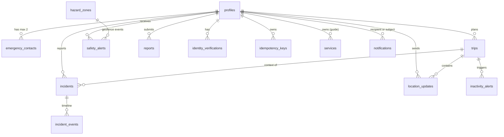

# SafeWay: Database Models (Pydantic v2 and TypeScript)

> **Version:** 1.0 · **Date:** 2026-10-10 · **Status:** Final for the 6-hour MVP
> **Team:** Minions · **Depends on:** [DATABASE_SCHEMA.md](DATABASE_SCHEMA.md) (authoritative for tables and enums), [PRD.md](PRD.md) (requirements)
> **Tags:** `[MVP]` built now · `[Post-MVP]` not modelled.
> **Scope note:** Only MVP models exist. No models for Post-MVP or removed tables, and no Aadhaar, passport or medical fields anywhere.

---

## 1. How to use this file

| Layer | Location | Contents |
|---|---|---|
| Python (FastAPI) | `apps/api/app/models/` | `enums.py`, `common.py`, `rows.py`, `requests.py`, `responses.py` |
| TypeScript (Next.js) | `apps/web/src/types/safeway.ts` | One file mirroring every Python name below |

- Three kinds of model: **Row** (a database row, read side), **Request** (client input), **Response** (API output).
- Field names are `snake_case` in both languages so JSON needs no mapping. Timestamps are ISO 8601 strings in TypeScript and timezone-aware `datetime` in Python.
- Enum values are copied from `DATABASE_SCHEMA.md`. If an enum changes there, change it in both files here in the same commit.
- The two language files are kept in sync by hand. Generated types (for example from the Supabase CLI) are `[Proposed]`; ask before adopting them.

### 1.1 Validation rules (apply to every Request model)

1. `extra="forbid"`: unknown fields are rejected. This is how the API refuses client-sent `role`, `user_id`, `status`, `severity`, `reference`, `assigned_to` or `verified_by`. Those values are always set by the server.
2. Latitude and longitude are range-checked. A pair is both present or both absent.
3. Phone numbers are E.164 (`+` then 8 to 15 digits), the same pattern as the database CHECK.
4. Strings are stripped and length-limited to match the database limits.
5. Identity requests have **no** field that could carry an Aadhaar or passport number. `extra="forbid"` keeps it that way.
6. Responses never contain a numeric safety or risk score. Risk is shown as an `advisory_level` plus plain-language factors.

---

## 2. Python: `enums.py` and `common.py`

```python
# apps/api/app/models/enums.py
from enum import StrEnum

class IncidentStatus(StrEnum):
    submitted = "submitted"; acknowledged = "acknowledged"; assigned = "assigned"
    in_progress = "in_progress"; resolved = "resolved"; closed = "closed"
    cancelled = "cancelled"; duplicate = "duplicate"

class IncidentCategory(StrEnum):       # locked (F3)
    medical = "medical"; accident = "accident"; lost_stranded = "lost_stranded"
    personal_safety = "personal_safety"; other = "other"

class Severity(StrEnum):
    low = "low"; medium = "medium"; high = "high"; critical = "critical"

class TripStatus(StrEnum):
    planned = "planned"; active = "active"; completed = "completed"; cancelled = "cancelled"

class AdvisoryLevel(StrEnum):
    info = "info"; caution = "caution"; warning = "warning"; critical = "critical"; unknown = "unknown"

class ServiceKind(StrEnum):
    guide = "guide"; taxi = "taxi"; hotel = "hotel"; operator = "operator"

class ServiceStatus(StrEnum):
    pending = "pending"; verified = "verified"; rejected = "rejected"

class ReportStatus(StrEnum):
    submitted = "submitted"; verified = "verified"; rejected = "rejected"

class ReportType(StrEnum):
    accident = "accident"; landslide = "landslide"; flood = "flood"
    roadblock = "roadblock"; scam = "scam"; harassment = "harassment"

class HazardSource(StrEnum):
    authority = "authority"; crowd = "crowd"; feed = "feed"; seed = "seed"

class HazardType(StrEnum):
    landslide = "landslide"; flood = "flood"; road_closure = "road_closure"
    road_repair = "road_repair"; wildlife = "wildlife"; low_network = "low_network"
    restricted = "restricted"

class IdentityProvider(StrEnum):
    mock = "mock"; offline_xml = "offline_xml"
    partner_sandbox = "partner_sandbox"; passport_manual = "passport_manual"

class IdentityStatus(StrEnum):
    pending = "pending"; verified = "verified"; rejected = "rejected"

class NotificationChannel(StrEnum):
    in_app = "in_app"; sms = "sms"

class NotificationStatus(StrEnum):
    pending = "pending"; sent = "sent"; failed = "failed"

class InactivityWindow(StrEnum):
    nudge = "nudge"; contact_sms = "contact_sms"

class InactivityStatus(StrEnum):
    fired = "fired"; cancelled = "cancelled"

class Role(StrEnum):                   # JWT app_metadata only, never a table column
    tourist = "tourist"; guide = "guide"; rescue = "rescue"; admin = "admin"

class DataQuality(StrEnum):
    good = "good"; partial = "partial"; stale = "stale"; missing = "missing"

class AuditAction(StrEnum):            # matches the CHECK on audit_ledger.action
    sos_submitted = "sos_submitted"
    incident_acknowledged = "incident_acknowledged"
    incident_assigned = "incident_assigned"
    incident_status_changed = "incident_status_changed"
    incident_cancelled = "incident_cancelled"
    role_changed = "role_changed"
    zone_activated = "zone_activated"
    zone_deactivated = "zone_deactivated"
    service_verified = "service_verified"
    service_rejected = "service_rejected"
    report_verified = "report_verified"
    report_rejected = "report_rejected"
    id_revoked = "id_revoked"
```

```python
# apps/api/app/models/common.py
from typing import Annotated, Generic, Literal, TypeVar
from pydantic import AwareDatetime, BaseModel, ConfigDict, Field, StringConstraints

Lat = Annotated[float, Field(ge=-90, le=90)]
Lng = Annotated[float, Field(ge=-180, le=180)]
Phone = Annotated[str, StringConstraints(pattern=r"^\+[1-9][0-9]{7,14}$")]

class ApiModel(BaseModel):
    """Base for every Request model: strict input, no unknown fields."""
    model_config = ConfigDict(extra="forbid", str_strip_whitespace=True)

class RowModel(BaseModel):
    """Base for Row and Response models built from database rows."""
    model_config = ConfigDict(from_attributes=True, extra="ignore")

class LatLng(ApiModel):
    lat: Lat
    lng: Lng

class LineString(RowModel):
    type: Literal["LineString"] = "LineString"
    coordinates: list[tuple[float, float]]      # [lng, lat] pairs (GeoJSON order)

# Error envelope: { "error": { "code", "message", "details" } }, no stack traces
class ErrorBody(BaseModel):
    code: str
    message: str
    details: dict | list | None = None

class ErrorResponse(BaseModel):
    error: ErrorBody

T = TypeVar("T")

class Page(BaseModel, Generic[T]):
    items: list[T]
    next_cursor: str | None = None              # pagination: limit + cursor
```

---

## 3. Python: `rows.py` (database rows)

One model per MVP table, matching `DATABASE_SCHEMA.md`. `idempotency_keys` has no public model (backend internal).

```python
# apps/api/app/models/rows.py
from uuid import UUID
from pydantic import AwareDatetime
from .common import RowModel
from .enums import *

class Profile(RowModel):
    id: UUID
    full_name: str
    phone: str | None = None
    language: str
    public_id: str
    public_id_revoked_at: AwareDatetime | None = None
    location_consent_at: AwareDatetime | None = None
    quiet_hours_enabled: bool
    created_at: AwareDatetime

class EmergencyContact(RowModel):
    id: UUID
    user_id: UUID
    name: str
    relationship: str
    phone: str
    priority: int                    # 1 or 2
    consent_at: AwareDatetime
    created_at: AwareDatetime

class Trip(RowModel):
    id: UUID
    user_id: UUID
    destination: str
    start_at: AwareDatetime
    end_at: AwareDatetime | None = None
    status: TripStatus
    route_geojson: dict | None = None
    reduced_fallback_ack_at: AwareDatetime | None = None
    last_heartbeat_at: AwareDatetime | None = None
    created_at: AwareDatetime

class Incident(RowModel):
    id: UUID
    reference: str                   # e.g. SW-000042
    reporter_id: UUID
    trip_id: UUID | None = None
    category: IncidentCategory
    severity: Severity
    status: IncidentStatus
    description: str | None = None
    lat: float | None = None
    lng: float | None = None
    accuracy_m: float | None = None
    location_recorded_at: AwareDatetime | None = None
    assigned_to: UUID | None = None
    client_id: UUID
    resolution_notes: str | None = None
    is_sample: bool
    created_at: AwareDatetime
    updated_at: AwareDatetime

class IncidentEvent(RowModel):
    id: UUID
    incident_id: UUID
    actor_id: UUID | None = None
    event_type: str                  # submitted, acknowledged, assigned, status_changed, en_route, on_site, note, cancelled
    details: dict
    is_internal: bool
    created_at: AwareDatetime

class HazardZone(RowModel):
    id: UUID
    name: str
    type: HazardType
    severity: Severity
    center_lat: float
    center_lng: float
    radius_m: int
    source: HazardSource
    active: bool
    starts_at: AwareDatetime | None = None
    expires_at: AwareDatetime | None = None
    reason: str | None = None
    created_by: UUID | None = None
    is_sample: bool
    created_at: AwareDatetime

class LocationUpdate(RowModel):
    id: UUID
    user_id: UUID
    trip_id: UUID | None = None
    lat: float
    lng: float
    accuracy_m: float | None = None
    speed: float | None = None
    recorded_at: AwareDatetime       # device time wins
    received_at: AwareDatetime
    client_id: UUID

class SafetyAlert(RowModel):
    id: UUID
    user_id: UUID
    trip_id: UUID | None = None
    zone_id: UUID | None = None
    level: AdvisoryLevel
    type: str                        # geofence_enter, geofence_exit, weather, stale_location
    message: str
    rule: str
    source: str
    reason: str | None = None
    data_quality: DataQuality
    suggested_action: str | None = None
    data_timestamp: AwareDatetime
    created_at: AwareDatetime
    read_at: AwareDatetime | None = None

class Notification(RowModel):
    id: UUID
    event_id: str
    recipient_user_id: UUID | None = None
    recipient_phone: str | None = None
    subject_user_id: UUID | None = None
    channel: NotificationChannel
    provider: str | None = None      # 'mock' | 'msg91'
    type: str                        # sos_contact_sms, inactivity_nudge, inactivity_contact_sms, incident_update
    payload: dict
    status: NotificationStatus
    attempts: int
    last_error: str | None = None
    created_at: AwareDatetime
    sent_at: AwareDatetime | None = None

class AuditEntry(RowModel):
    id: int
    prev_hash: str
    entry_hash: str
    actor_id: UUID | None = None
    action: AuditAction
    entity_type: str
    entity_id: str | None = None
    created_at: AwareDatetime

class Service(RowModel):
    id: UUID
    kind: ServiceKind
    name: str
    owner_id: UUID | None = None
    status: ServiceStatus
    contact: str | None = None
    area: str | None = None
    verified_by: UUID | None = None
    verified_at: AwareDatetime | None = None
    is_sample: bool
    created_at: AwareDatetime

class PriceBaseline(RowModel):
    id: UUID
    kind: ServiceKind
    route_or_item: str
    min_price: int                   # INR
    max_price: int
    source: str
    is_sample: bool
    updated_at: AwareDatetime

class Report(RowModel):
    id: UUID
    user_id: UUID
    type: ReportType
    description: str | None = None
    lat: float
    lng: float
    media_path: str | None = None
    status: ReportStatus
    verified_by: UUID | None = None
    verified_at: AwareDatetime | None = None
    client_id: UUID
    created_at: AwareDatetime

class InactivityAlert(RowModel):
    id: UUID
    trip_id: UUID
    user_id: UUID
    window: InactivityWindow
    heartbeat_at: AwareDatetime
    fired_at: AwareDatetime
    status: InactivityStatus
    cancelled_at: AwareDatetime | None = None

class IdentityVerification(RowModel):
    id: UUID
    user_id: UUID
    provider: IdentityProvider
    status: IdentityStatus
    reference_id: str | None = None  # provider reference, never an Aadhaar number
    verified_at: AwareDatetime | None = None
    created_at: AwareDatetime
```

---

## 4. Python: `requests.py` (client input)

All inherit `ApiModel`. Never include `user_id`, `role`, `status` (except where the client legitimately chooses a decision), `severity`, `reference`, `assigned_to` or `verified_by`.

```python
# apps/api/app/models/requests.py
from typing import Literal
from uuid import UUID
from pydantic import AwareDatetime, Field, model_validator
from .common import ApiModel, Lat, Lng, LatLng, Phone
from .enums import *

# ---- Me ----
class MeUpdate(ApiModel):
    full_name: str | None = Field(None, min_length=1, max_length=100)
    phone: Phone | None = None
    language: str | None = Field(None, min_length=2, max_length=10)
    location_consent: bool | None = None            # server stamps location_consent_at
    quiet_hours_enabled: bool | None = None

# ---- Trips ----
class TripCreate(ApiModel):
    destination: str = Field(min_length=1, max_length=200)
    start_at: AwareDatetime
    end_at: AwareDatetime | None = None
    route_geojson: dict | None = None

class TripStart(ApiModel):
    reduced_fallback_acknowledged: bool = False     # needed only when exactly one contact exists

class TripUpdate(ApiModel):
    destination: str | None = Field(None, min_length=1, max_length=200)
    end_at: AwareDatetime | None = None

# ---- Location and check-in ----
class LocationPoint(ApiModel):
    client_id: UUID
    trip_id: UUID | None = None
    lat: Lat
    lng: Lng
    accuracy_m: float | None = Field(None, ge=0)
    speed: float | None = Field(None, ge=0)
    recorded_at: AwareDatetime

class LocationBatch(ApiModel):                      # POST /location/batch (Idempotency-Key header)
    points: list[LocationPoint] = Field(min_length=1, max_length=100)

class CheckinRequest(ApiModel):                     # POST /checkins ("I'm safe")
    trip_id: UUID | None = None

# ---- SOS and incidents ----
class SosRequest(ApiModel):                         # POST /sos (Idempotency-Key header must equal client_id)
    client_id: UUID
    category: IncidentCategory
    description: str | None = Field(None, max_length=2000)
    trip_id: UUID | None = None
    lat: Lat | None = None
    lng: Lng | None = None
    accuracy_m: float | None = Field(None, ge=0)
    location_recorded_at: AwareDatetime | None = None

    @model_validator(mode="after")
    def _location_all_or_none(self):
        has = [self.lat is not None, self.lng is not None, self.location_recorded_at is not None]
        if any(has) and not all(has):
            raise ValueError("lat, lng and location_recorded_at must be sent together or not at all")
        return self                                  # no GPS is valid: SOS proceeds without it

class SosCancel(ApiModel):
    reason: str | None = Field(None, max_length=500)

class IncidentAssign(ApiModel):                     # POST /incidents/{id}/assign (rescue, admin)
    assignee_id: UUID                                # must be an active rescue or admin account (checked server-side)
    note: str | None = Field(None, max_length=500)

class IncidentStatusChange(ApiModel):               # POST /incidents/{id}/status (rescue, admin)
    status: Literal[
        IncidentStatus.in_progress, IncidentStatus.resolved,
        IncidentStatus.closed, IncidentStatus.duplicate,
    ] | None = None
    event_type: Literal["en_route", "on_site", "note"] | None = None   # events inside in_progress, or a note
    note: str | None = Field(None, max_length=2000)
    is_internal: bool = False                        # internal notes are hidden from the tourist timeline

    @model_validator(mode="after")
    def _needs_status_or_event(self):
        if self.status is None and self.event_type is None:
            raise ValueError("send a status, an event_type, or both")
        if self.event_type == "note" and not self.note:
            raise ValueError("a note event needs text")
        return self
# acknowledge: POST /incidents/{id}/acknowledge takes no body.
# duplicate is admin only; cancelled has its own endpoint (POST /sos/{id}/cancel). Both checked server-side.

# ---- Routes, weather, price ----
class RouteRankRequest(ApiModel):
    origin: LatLng
    destination: LatLng
    departure_time: AwareDatetime | None = None      # feeds the night factor

class PriceCheckRequest(ApiModel):
    kind: ServiceKind
    route_or_item: str = Field(min_length=1, max_length=200)
    quoted_price: int = Field(ge=0, le=10_000_000)   # INR

# ---- Reports ----
class ReportCreate(ApiModel):                        # POST /reports (Idempotency-Key header must equal client_id)
    client_id: UUID
    type: ReportType
    description: str | None = Field(None, max_length=1000)
    lat: Lat                                         # location required
    lng: Lng
    media_path: str | None = Field(None, max_length=300)   # path under report-media/<user_id>/

class ReportDecision(ApiModel):                      # PATCH /admin/reports/{id}/verify
    decision: Literal[ReportStatus.verified, ReportStatus.rejected]

# ---- Admin: zones and services ----
class ZoneCreate(ApiModel):                          # POST /admin/zones
    name: str = Field(min_length=1, max_length=200)
    type: HazardType
    severity: Severity
    center_lat: Lat
    center_lng: Lng
    radius_m: int = Field(gt=0, le=50_000)
    source: Literal[HazardSource.authority, HazardSource.crowd] = HazardSource.authority
    starts_at: AwareDatetime | None = None
    expires_at: AwareDatetime | None = None
    reason: str | None = Field(None, max_length=500)
    # seed and feed sources are never client-set. A zone from a verified report is created manually by an admin (crowd).

class ZoneUpdate(ApiModel):                          # PATCH /admin/zones/{id}
    name: str | None = Field(None, min_length=1, max_length=200)
    severity: Severity | None = None
    radius_m: int | None = Field(None, gt=0, le=50_000)
    active: bool | None = None
    starts_at: AwareDatetime | None = None
    expires_at: AwareDatetime | None = None
    reason: str | None = Field(None, max_length=500)

class ServiceDecision(ApiModel):                     # PATCH /admin/services/{id}/verify
    decision: Literal[ServiceStatus.verified, ServiceStatus.rejected]

# ---- Identity (mock only in MVP) ----
class IdentityVerifyRequest(ApiModel):               # POST /identity/verify
    provider: Literal[IdentityProvider.mock, IdentityProvider.passport_manual]
    # Intentionally no number or document fields. Aadhaar numbers are never collected.
```

---

## 5. Python: `responses.py` (API output)

```python
# apps/api/app/models/responses.py
from typing import Literal
from uuid import UUID
from pydantic import AwareDatetime
from .common import LatLng, LineString, RowModel
from .enums import *
from .rows import *

# ---- Me ----
class MeResponse(RowModel):
    profile: Profile
    role: Role
    contacts: list[EmergencyContact]
    active_trip_id: UUID | None = None
    identity_verified: bool                          # badge only; never any document data

# ---- SOS and incidents ----
class SosResponse(RowModel):
    incident_id: UUID
    reference: str
    status: IncidentStatus                           # "submitted": received by SafeWay, not "a responder has seen it"
    created_at: AwareDatetime
    duplicate: bool = False                          # true when an idempotent retry returned the existing incident

class ReporterSummary(RowModel):                     # staff view: only permitted fields (final list in AUTH_REQUIREMENTS.md)
    full_name: str
    public_id: str
    phone: str | None = None

class IncidentDetail(RowModel):                      # GET /incidents/{id}
    incident: Incident
    events: list[IncidentEvent]                      # tourists never receive is_internal events
    reporter: ReporterSummary | None = None          # staff only
    assigned_to_name: str | None = None

# ---- Location ----
class LocationBatchResponse(RowModel):
    accepted: int
    duplicates: int
    alerts: list[SafetyAlert]                        # geofence alerts created by this batch (state changes only)
    last_received_at: AwareDatetime | None = None

class CheckinResponse(RowModel):
    trip_id: UUID
    last_heartbeat_at: AwareDatetime

# ---- Routes and weather ----
class RiskFactor(RowModel):                          # qualitative only, no numeric score
    name: Literal["hazard_proximity", "weather_severity", "night_factor", "report_density"]
    level: AdvisoryLevel
    explanation: str
    source: str
    data_timestamp: AwareDatetime | None = None

class RankedRoute(RowModel):
    route_id: str
    rank: int                                        # 1 = lowest rule-based risk among the alternatives
    distance_m: float
    duration_s: float
    geometry: LineString
    advisory_level: AdvisoryLevel                    # unknown when inputs are missing; never "safe"
    factors: list[RiskFactor]
    hazard_zone_ids: list[UUID]                      # zones the route passes near
    avoided_zone_ids: list[UUID] = []

class WeatherCard(RowModel):
    available: bool
    message: str | None = None                       # "Weather data unavailable" when available is false
    observed_at: AwareDatetime | None = None
    source: str = "OpenWeather (external weather information)"
    summary: str | None = None
    temperature_c: float | None = None
    wind_kph: float | None = None
    precipitation_mm: float | None = None

class RouteRankResponse(RowModel):
    routes: list[RankedRoute]
    weather: WeatherCard
    generated_at: AwareDatetime
    note: str = "Rule-based, explainable ranking. Not a guarantee of safety."
    is_recorded_sample: bool = False                 # true if the cut-ladder pre-recorded response is served

# ---- Price ----
class PriceCheckResponse(RowModel):
    baseline_found: bool
    verdict: Literal["within_range", "too_high", "below_range", "no_baseline"]
    quoted_price: int
    min_price: int | None = None                     # always a range, never a single number
    max_price: int | None = None
    message: str                                     # e.g. "price seems too high"
    source: str | None = None
    is_sample: bool = False                          # UI shows "sample data"

# ---- Services ----
class ServiceView(RowModel):                         # tourist-facing; only verified services are returned
    id: UUID
    kind: ServiceKind
    name: str
    contact: str | None = None
    area: str | None = None
    verified_at: AwareDatetime | None = None
    is_sample: bool

# ---- Public QR page ----
class PublicIdVerifyResponse(RowModel):              # GET /id/{public_id}/verify (public, rate-limited)
    valid: bool
    display_name: str | None = None                  # all other fields are None when valid is false
    tourist_id: str | None = None
    trip_status: TripStatus | None = None
    identity_verified: bool | None = None

class QrRegenerateResponse(RowModel):
    public_id: str

# ---- Audit and jobs ----
class AuditVerifyResponse(RowModel):                 # GET /audit/verify
    ok: bool
    entries_checked: int
    first_bad_id: int | None = None
    reason: str | None = None

class SweepResponse(RowModel):                       # POST /admin/jobs/inactivity-sweep and /internal/jobs/inactivity-sweep
    demo_mode: bool
    nudge_window_s: int                              # 60 in demo, 10800 in real mode
    contact_sms_window_s: int                        # 120 in demo, 14400 in real mode
    nudges_created: int
    contact_sms_created: int
    skipped_quiet_hours: int
    cancelled_by_checkin: int

# ---- Health ----
class HealthResponse(RowModel):
    status: Literal["ok"]
class ReadyResponse(RowModel):
    status: Literal["ready", "degraded"]
    database: bool
    dependencies: dict[str, bool]                    # e.g. {"openrouteservice": true, "openweather": false}
```

Lists (`GET /incidents`, `/services`, `/zones`, `/admin/audit`) return `Page[Model]`.

---

## 6. TypeScript: `apps/web/src/types/safeway.ts`

```ts
// ---------- Enums (string unions mirror the Python StrEnums) ----------
export type IncidentStatus = 'submitted' | 'acknowledged' | 'assigned' | 'in_progress' | 'resolved' | 'closed' | 'cancelled' | 'duplicate';
export type IncidentCategory = 'medical' | 'accident' | 'lost_stranded' | 'personal_safety' | 'other';
export type Severity = 'low' | 'medium' | 'high' | 'critical';
export type TripStatus = 'planned' | 'active' | 'completed' | 'cancelled';
export type AdvisoryLevel = 'info' | 'caution' | 'warning' | 'critical' | 'unknown';
export type ServiceKind = 'guide' | 'taxi' | 'hotel' | 'operator';
export type ServiceStatus = 'pending' | 'verified' | 'rejected';
export type ReportStatus = 'submitted' | 'verified' | 'rejected';
export type ReportType = 'accident' | 'landslide' | 'flood' | 'roadblock' | 'scam' | 'harassment';
export type HazardSource = 'authority' | 'crowd' | 'feed' | 'seed';
export type HazardType = 'landslide' | 'flood' | 'road_closure' | 'road_repair' | 'wildlife' | 'low_network' | 'restricted';
export type IdentityProvider = 'mock' | 'offline_xml' | 'partner_sandbox' | 'passport_manual';
export type IdentityStatus = 'pending' | 'verified' | 'rejected';
export type NotificationChannel = 'in_app' | 'sms';
export type NotificationStatus = 'pending' | 'sent' | 'failed';
export type InactivityWindow = 'nudge' | 'contact_sms';
export type InactivityStatus = 'fired' | 'cancelled';
export type Role = 'tourist' | 'guide' | 'rescue' | 'admin';
export type DataQuality = 'good' | 'partial' | 'stale' | 'missing';

export const SOS_CATEGORIES: readonly IncidentCategory[] =
  ['medical', 'accident', 'lost_stranded', 'personal_safety', 'other'];   // locked (F3)

// ---------- Common ----------
export type ISODate = string;
export type UUID = string;
export interface LatLng { lat: number; lng: number }
export interface LineString { type: 'LineString'; coordinates: [number, number][] }   // [lng, lat]
export interface ErrorResponse { error: { code: string; message: string; details?: unknown } }
export interface Page<T> { items: T[]; next_cursor: string | null }

// ---------- Rows ----------
export interface Profile {
  id: UUID; full_name: string; phone: string | null; language: string; public_id: string;
  public_id_revoked_at: ISODate | null; location_consent_at: ISODate | null;
  quiet_hours_enabled: boolean; created_at: ISODate;
}
export interface EmergencyContact {
  id: UUID; user_id: UUID; name: string; relationship: string; phone: string;
  priority: 1 | 2; consent_at: ISODate; created_at: ISODate;
}
export interface Trip {
  id: UUID; user_id: UUID; destination: string; start_at: ISODate; end_at: ISODate | null;
  status: TripStatus; route_geojson: unknown | null; reduced_fallback_ack_at: ISODate | null;
  last_heartbeat_at: ISODate | null; created_at: ISODate;
}
export interface Incident {
  id: UUID; reference: string; reporter_id: UUID; trip_id: UUID | null;
  category: IncidentCategory; severity: Severity; status: IncidentStatus;
  description: string | null; lat: number | null; lng: number | null; accuracy_m: number | null;
  location_recorded_at: ISODate | null; assigned_to: UUID | null; client_id: UUID;
  resolution_notes: string | null; is_sample: boolean; created_at: ISODate; updated_at: ISODate;
}
export interface IncidentEvent {
  id: UUID; incident_id: UUID; actor_id: UUID | null; event_type: string;
  details: Record<string, unknown>; is_internal: boolean; created_at: ISODate;
}
export interface HazardZone {
  id: UUID; name: string; type: HazardType; severity: Severity;
  center_lat: number; center_lng: number; radius_m: number; source: HazardSource;
  active: boolean; starts_at: ISODate | null; expires_at: ISODate | null; reason: string | null;
  created_by: UUID | null; is_sample: boolean; created_at: ISODate;
}
export interface LocationUpdate {
  id: UUID; user_id: UUID; trip_id: UUID | null; lat: number; lng: number;
  accuracy_m: number | null; speed: number | null; recorded_at: ISODate; received_at: ISODate; client_id: UUID;
}
export interface SafetyAlert {
  id: UUID; user_id: UUID; trip_id: UUID | null; zone_id: UUID | null; level: AdvisoryLevel;
  type: string; message: string; rule: string; source: string; reason: string | null;
  data_quality: DataQuality; suggested_action: string | null; data_timestamp: ISODate;
  created_at: ISODate; read_at: ISODate | null;
}
export interface Notification {
  id: UUID; event_id: string; recipient_user_id: UUID | null; recipient_phone: string | null;
  subject_user_id: UUID | null; channel: NotificationChannel; provider: 'mock' | 'msg91' | null;
  type: string; payload: Record<string, unknown>; status: NotificationStatus; attempts: number;
  last_error: string | null; created_at: ISODate; sent_at: ISODate | null;
}
export interface AuditEntry {
  id: number; prev_hash: string; entry_hash: string; actor_id: UUID | null;
  action: string; entity_type: string; entity_id: string | null; created_at: ISODate;
}
export interface Service {
  id: UUID; kind: ServiceKind; name: string; owner_id: UUID | null; status: ServiceStatus;
  contact: string | null; area: string | null; verified_by: UUID | null; verified_at: ISODate | null;
  is_sample: boolean; created_at: ISODate;
}
export interface PriceBaseline {
  id: UUID; kind: ServiceKind; route_or_item: string; min_price: number; max_price: number;
  source: string; is_sample: boolean; updated_at: ISODate;
}
export interface Report {
  id: UUID; user_id: UUID; type: ReportType; description: string | null; lat: number; lng: number;
  media_path: string | null; status: ReportStatus; verified_by: UUID | null; verified_at: ISODate | null;
  client_id: UUID; created_at: ISODate;
}
export interface InactivityAlert {
  id: UUID; trip_id: UUID; user_id: UUID; window: InactivityWindow; heartbeat_at: ISODate;
  fired_at: ISODate; status: InactivityStatus; cancelled_at: ISODate | null;
}
export interface IdentityVerification {
  id: UUID; user_id: UUID; provider: IdentityProvider; status: IdentityStatus;
  reference_id: string | null; verified_at: ISODate | null; created_at: ISODate;
}

// ---------- Requests ----------
export interface MeUpdate { full_name?: string; phone?: string; language?: string; location_consent?: boolean; quiet_hours_enabled?: boolean }
export interface TripCreate { destination: string; start_at: ISODate; end_at?: ISODate; route_geojson?: unknown }
export interface TripStart { reduced_fallback_acknowledged?: boolean }
export interface TripUpdate { destination?: string; end_at?: ISODate }
export interface LocationPoint { client_id: UUID; trip_id?: UUID; lat: number; lng: number; accuracy_m?: number; speed?: number; recorded_at: ISODate }
export interface LocationBatch { points: LocationPoint[] }
export interface CheckinRequest { trip_id?: UUID }
export interface SosRequest {
  client_id: UUID; category: IncidentCategory; description?: string; trip_id?: UUID;
  lat?: number; lng?: number; accuracy_m?: number; location_recorded_at?: ISODate;  // lat, lng, location_recorded_at together or none
}
export interface SosCancel { reason?: string }
export interface IncidentAssign { assignee_id: UUID; note?: string }
export interface IncidentStatusChange {
  status?: 'in_progress' | 'resolved' | 'closed' | 'duplicate';
  event_type?: 'en_route' | 'on_site' | 'note'; note?: string; is_internal?: boolean;
}
export interface RouteRankRequest { origin: LatLng; destination: LatLng; departure_time?: ISODate }
export interface PriceCheckRequest { kind: ServiceKind; route_or_item: string; quoted_price: number }
export interface ReportCreate { client_id: UUID; type: ReportType; description?: string; lat: number; lng: number; media_path?: string }
export interface ReportDecision { decision: 'verified' | 'rejected' }
export interface ZoneCreate {
  name: string; type: HazardType; severity: Severity; center_lat: number; center_lng: number; radius_m: number;
  source?: 'authority' | 'crowd'; starts_at?: ISODate; expires_at?: ISODate; reason?: string;
}
export interface ZoneUpdate { name?: string; severity?: Severity; radius_m?: number; active?: boolean; starts_at?: ISODate; expires_at?: ISODate; reason?: string }
export interface ServiceDecision { decision: 'verified' | 'rejected' }
export interface IdentityVerifyRequest { provider: 'mock' | 'passport_manual' }

// ---------- Responses ----------
export interface MeResponse { profile: Profile; role: Role; contacts: EmergencyContact[]; active_trip_id: UUID | null; identity_verified: boolean }
export interface SosResponse { incident_id: UUID; reference: string; status: IncidentStatus; created_at: ISODate; duplicate: boolean }
export interface ReporterSummary { full_name: string; public_id: string; phone: string | null }
export interface IncidentDetail { incident: Incident; events: IncidentEvent[]; reporter: ReporterSummary | null; assigned_to_name: string | null }
export interface LocationBatchResponse { accepted: number; duplicates: number; alerts: SafetyAlert[]; last_received_at: ISODate | null }
export interface CheckinResponse { trip_id: UUID; last_heartbeat_at: ISODate }
export interface RiskFactor {
  name: 'hazard_proximity' | 'weather_severity' | 'night_factor' | 'report_density';
  level: AdvisoryLevel; explanation: string; source: string; data_timestamp: ISODate | null;
}
export interface RankedRoute {
  route_id: string; rank: number; distance_m: number; duration_s: number; geometry: LineString;
  advisory_level: AdvisoryLevel; factors: RiskFactor[]; hazard_zone_ids: UUID[]; avoided_zone_ids: UUID[];
}
export interface WeatherCard {
  available: boolean; message: string | null; observed_at: ISODate | null; source: string;
  summary: string | null; temperature_c: number | null; wind_kph: number | null; precipitation_mm: number | null;
}
export interface RouteRankResponse { routes: RankedRoute[]; weather: WeatherCard; generated_at: ISODate; note: string; is_recorded_sample: boolean }
export interface PriceCheckResponse {
  baseline_found: boolean; verdict: 'within_range' | 'too_high' | 'below_range' | 'no_baseline';
  quoted_price: number; min_price: number | null; max_price: number | null; message: string;
  source: string | null; is_sample: boolean;
}
export interface ServiceView { id: UUID; kind: ServiceKind; name: string; contact: string | null; area: string | null; verified_at: ISODate | null; is_sample: boolean }
export interface PublicIdVerifyResponse { valid: boolean; display_name: string | null; tourist_id: string | null; trip_status: TripStatus | null; identity_verified: boolean | null }
export interface QrRegenerateResponse { public_id: string }
export interface AuditVerifyResponse { ok: boolean; entries_checked: number; first_bad_id: number | null; reason: string | null }
export interface SweepResponse {
  demo_mode: boolean; nudge_window_s: number; contact_sms_window_s: number;
  nudges_created: number; contact_sms_created: number; skipped_quiet_hours: number; cancelled_by_checkin: number;
}

// ---------- Client-only types (never sent to the database as statuses) ----------
export type SosUiState = 'draft' | 'pending' | 'submitted' | 'failed' | 'manually_sent';

export interface QueuedSos {                      // IndexedDB store "sos_queue"
  client_id: UUID;                                // doubles as Idempotency-Key
  payload: SosRequest;
  ui_state: SosUiState;
  created_at: ISODate;
  attempts: number;
  next_retry_at: ISODate | null;
  last_error: string | null;
  incident_reference: string | null;              // set once the server confirms
}
export interface QueuedLocation { client_id: UUID; point: LocationPoint; attempts: number }
export interface QueuedReport { client_id: UUID; payload: ReportCreate; attempts: number; last_error: string | null }
```

---

## 7. ER overview



Not drawn: `audit_ledger` (a standalone hash chain written only by `append_audit_entry`, with no foreign keys) and `price_baselines` (a standalone reference table). `incidents.assigned_to`, `hazard_zones.created_by`, `services.verified_by` and `reports.verified_by` also point to `profiles`.

---

## 8. Model to table to endpoint map

| Model group | Table(s) | Written by | Read by |
|---|---|---|---|
| `Profile`, `MeUpdate`, `MeResponse` | `profiles`, `emergency_contacts`, `identity_verifications` | Browser (own columns) and FastAPI | Browser (RLS) and FastAPI |
| `EmergencyContact` | `emergency_contacts` | Browser under RLS (no FastAPI endpoint) | Browser |
| `Trip*`, `Checkin*` | `trips` | FastAPI | Browser |
| `LocationBatch*` | `location_updates`, `safety_alerts` | FastAPI | Browser (own) |
| `SosRequest`, `Incident*` | `incidents`, `incident_events`, `notifications`, `audit_ledger` | FastAPI (one transaction) | Browser (RLS), FastAPI for staff detail |
| `RouteRank*`, `WeatherCard` | `hazard_zones`, `reports`, weather API | FastAPI | n/a |
| `PriceCheck*` | `price_baselines` | FastAPI | n/a |
| `Service*` | `services` | FastAPI (admin approval) | Browser (RLS) |
| `Report*` | `reports`, `report-media` bucket | FastAPI | Own and admin |
| `Zone*` | `hazard_zones` | FastAPI (admin) | Browser (RLS) |
| `PublicIdVerifyResponse` | `profiles`, `trips`, `identity_verifications` | n/a | FastAPI public endpoint |
| `AuditVerifyResponse` | `audit_ledger` | n/a | FastAPI (`verify_audit_chain`) |
| `SweepResponse` | `trips`, `inactivity_alerts`, `notifications` | FastAPI | Admin console |

---

## 9. Model tests (Pydantic, `pytest`)

Cover at least these, one file `tests/test_models.py`:

1. Every request model rejects an unknown field such as `role`, `user_id`, `status`, `severity` or `assigned_to`.
2. `SosRequest` accepts no location; accepts a full location; rejects `lat` without `lng` or `location_recorded_at`; rejects any category outside the five locked values.
3. `LocationBatch` rejects an empty list and more than 100 points.
4. `IncidentStatusChange` rejects an empty body, a `note` event with no text, and the statuses `cancelled`, `acknowledged`, `assigned`.
5. `Phone` rejects numbers without `+` or with fewer than 8 digits.
6. `ZoneCreate` rejects `source` of `seed` or `feed`.
7. `IdentityVerifyRequest` rejects any extra field (so no Aadhaar number can be passed), and rejects `offline_xml` and `partner_sandbox`.
8. Every enum in `enums.py` has exactly the values listed in `DATABASE_SCHEMA.md` (compare against a hardcoded list).
9. `RankedRoute` and `RouteRankResponse` contain no numeric risk field.

---

## 10. Removed and unused (explicitly out)

No models for: `price_submissions`, `device_tokens`, `weather_cache`, `responder_profiles`, `sync_log`, `user_roles`, `responder_assignments`, `incident_media`, `family_links`; no `ScoreResponse`, no 0 to 100 `safety_score`; no `role` field in any Request or Row; no Aadhaar, passport, medical-note or document fields; no WebSocket message models (Supabase Realtime delivers row changes as the `Incident`, `IncidentEvent`, `SafetyAlert` and `Notification` shapes above).

---

## 11. Related documents

[PRD.md](PRD.md) · [DATABASE_SCHEMA.md](DATABASE_SCHEMA.md) · `AUTH_REQUIREMENTS.md` · `SECURITY.md` · `BUSINESS_LOGIC.md` · `API_STRUCTURE.md` · `API_ENDPOINTS.md` · `README.md`. Next in the build order: `AUTH_REQUIREMENTS.md`.
