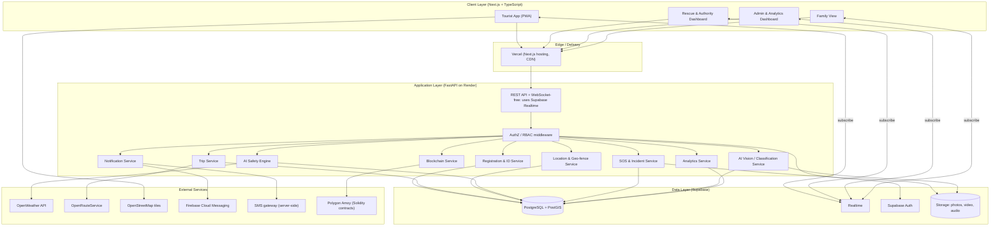
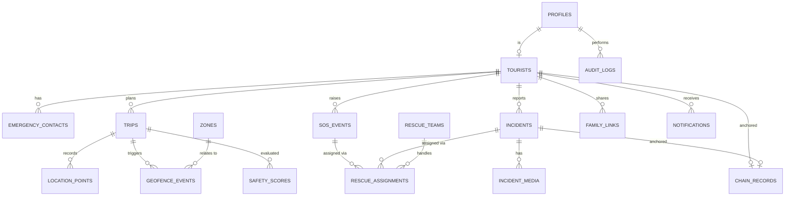
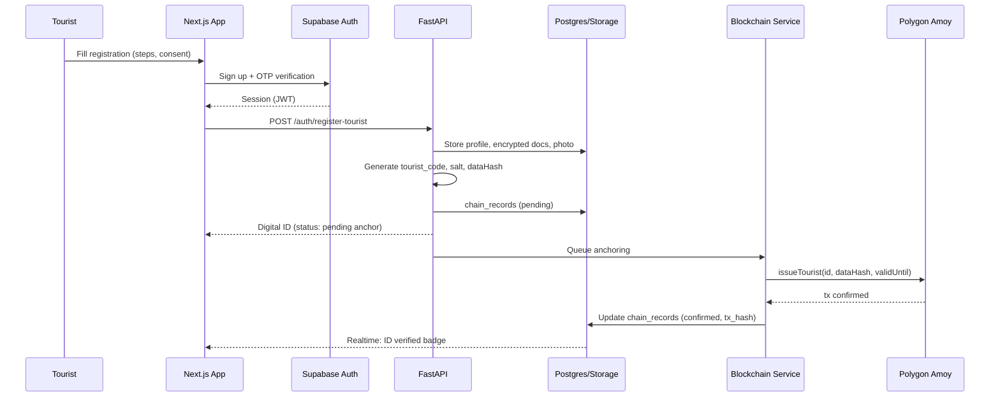
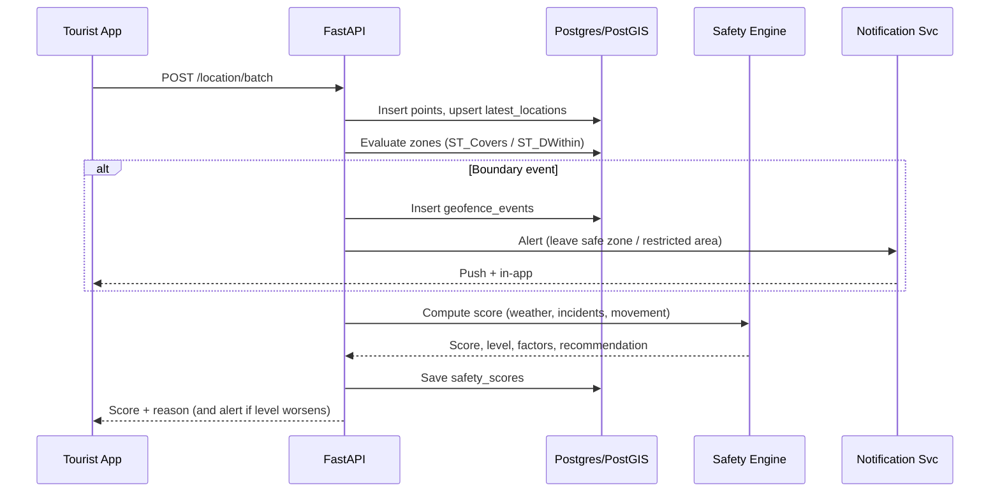
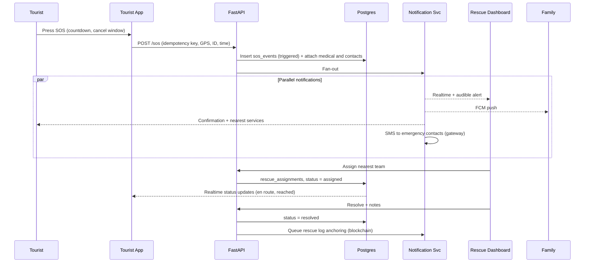
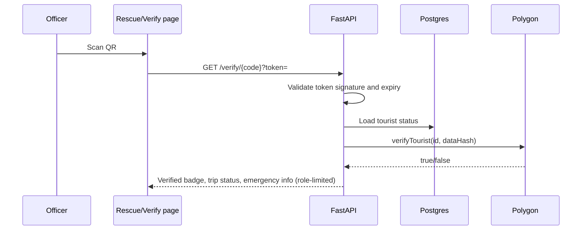

# Smart Tourist Safety Monitoring & Incident Response System
## System Architecture Document
**Problem statement:** Smart Tourist Safety Monitoring & Incident Response System using AI, Geo-Fencing, and Blockchain-based Digital ID

| Item | Value |
|---|---|
| Document type | High-level + detailed design (hackathon scope, production-aware) |
| Systems covered | Tourist App · Rescue & Authority Dashboard · Admin & Analytics Dashboard |
| Modules covered | All 20 modules from the feature list |
| Stack | Next.js · TypeScript · Tailwind · shadcn/ui · Framer Motion · FastAPI · Supabase · Leaflet + OSM + OpenRouteService · OpenWeather · Firebase Cloud Messaging · Polygon Amoy + Solidity + Hardhat · Vercel + Render |

---

## 1. Purpose and Scope

This document defines how the platform is built: components, data, interfaces, flows, security and deployment. It maps every feature module to a concrete component so the team can divide work and the judges can see a coherent, end-to-end design.

**In scope:** tourist registration and digital ID, trip planning, live tracking, geo-fencing, AI safety scoring, SOS, incident reporting, AI vision, weather alerts, emergency services lookup, family dashboard, notifications, history, admin/rescue dashboards, blockchain anchoring, analytics, settings.

**Out of scope (for the hackathon build):** native mobile apps, real police/ambulance (CAD) system integration, mainnet blockchain deployment, production-grade SMS/voice telephony contracts.

---

## 2. Architecture Goals, Principles and Constraints

### 2.1 Goals
1. **Safety-critical path first** — SOS, location and alerts must work with the least possible dependencies.
2. **Real-time** — rescue teams see location and SOS updates within seconds.
3. **Tamper-evident records** — IDs, verified incidents and rescue logs can be proven unaltered.
4. **Privacy by design** — personal data stays off-chain; sharing is consent-based.
5. **Explainable AI** — every score/alert comes with a reason.
6. **Deployable on free tiers** — for demo and hackathon cost limits.

### 2.2 Principles
- Single source of truth: **Supabase Postgres** (with PostGIS).
- **Blockchain stores hashes only**, never personal data.
- Backend is **stateless**; state lives in the database.
- Every write that matters is **audited**.
- **Graceful degradation**: if AI, weather, or chain is down, SOS and tracking still work.

### 2.3 Constraints and honest limitations (important for accuracy)

| Constraint | Impact | Mitigation |
|---|---|---|
| A web app (PWA) **cannot track location reliably in the background**; browsers throttle or suspend it when the screen is off or the tab is hidden | Live tracking works best while the app is open | For the demo keep the app foreground / screen-on; for production wrap with **Capacitor** (native background geolocation) or build a native app |
| A browser **cannot send SMS** or detect hardware power-button presses | "SMS fallback" and "silent SOS via power button" are not possible in a pure web app | SMS is sent **server-side** via an SMS gateway (e.g., Twilio, MSG91) when the SOS reaches the backend; silent SOS in web = disguised on-screen trigger; hardware trigger needs a native wrapper |
| Offline SOS cannot reach the server without any network | Needs a network path | Queue locally and retry; native app could use SMS intent; show emergency numbers to call |
| Render free tier **spins down on inactivity** (cold start) | First request may be slow | Keep-alive ping/cron or paid instance for the demo |
| Supabase free tier has connection, storage and Realtime limits | Limits under load | Pool connections, batch location writes, throttle updates |
| Leaflet + public OSM tiles have a **tile usage policy** (not for heavy production traffic); OpenRouteService free tier has **rate limits** | Throttling under load | Cache routes/tiles; use a tile provider or self-host for production |
| Polygon **Amoy is a testnet**; tokens have no value; chain can be reset/deprecated | Not a production ledger | Treat as demo; design contracts to be portable to a permissioned chain or mainnet |
| Camera-based hazard detection accuracy depends on training data | False positives/negatives | Show confidence; require human verification before broadcast |

---

## 3. High-Level Architecture

### 3.1 Logical view



### 3.2 Layered summary (text version)

```
┌──────────────────────────────────────────────────────────────────────┐
│ PRESENTATION   Tourist PWA │ Rescue Dashboard │ Admin Dashboard │ Family│
│                Next.js · TS · Tailwind · shadcn/ui · Framer Motion · Leaflet │
├──────────────────────────────────────────────────────────────────────┤
│ APPLICATION    FastAPI: Auth/RBAC · Registration/ID · Trip · Location/Geofence │
│                AI Safety · SOS/Incident · Vision · Notifications · Chain · Analytics │
├──────────────────────────────────────────────────────────────────────┤
│ DATA           Supabase: Postgres+PostGIS · Auth · Storage · Realtime │
├──────────────────────────────────────────────────────────────────────┤
│ INTEGRITY      Polygon Amoy: TouristRegistry contract (hashes only)  │
├──────────────────────────────────────────────────────────────────────┤
│ EXTERNAL       OpenWeather · OpenRouteService · OSM · FCM · SMS gateway │
└──────────────────────────────────────────────────────────────────────┘
```

---

## 4. Technology Stack and Responsibilities

| Layer | Technology | Responsibility |
|---|---|---|
| Frontend framework | **Next.js + TypeScript** | Routing, SSR/CSR, PWA shell, typed API clients |
| UI | **Tailwind CSS + shadcn/ui** | Components, theming (dark mode) |
| Animation | **Framer Motion** | Transitions, SOS countdown, alert animations |
| Maps | **Leaflet + OpenStreetMap** | Map rendering, markers, geo-fence polygons |
| Routing | **OpenRouteService** | Route, distance, duration, alternatives |
| Backend | **FastAPI (Python)** | Business logic, AI inference, integrations, chain calls |
| Database | **Supabase Postgres + PostGIS** | Relational + geospatial data |
| Auth | **Supabase Auth** | Email/password and phone OTP (OTP needs an SMS provider configured), JWT sessions |
| Storage | **Supabase Storage** | Photos, videos, voice notes, ID photos |
| Realtime | **Supabase Realtime** | Live location, SOS, incident and alert streams |
| Weather | **OpenWeather API** | Current/forecast weather, alerts |
| Push | **Firebase Cloud Messaging** | Push notifications (web push via service worker) |
| Blockchain | **Solidity + Hardhat on Polygon Amoy** | Digital ID, verified incidents, rescue logs, guide verification |
| Web3 library | **web3.py** (backend) / **ethers.js** (client verify) | Contract calls and verification |
| Hosting | **Vercel** (frontend), **Render** (backend) | Deployment |
| AI/ML (proposed) | scikit-learn / XGBoost, a YOLO-family model or a hosted vision API, a text classifier | Safety scoring, anomaly detection, vision, incident classification |

> The AI/ML tools are a proposal; the other items are the chosen stack.

---

## 5. Component Architecture

### 5.1 Client applications

| App | Users | Key screens | Notes |
|---|---|---|---|
| **Tourist App (PWA)** | Tourists | Home, Register/Login, Digital ID, Trip Planner, Live Map, Safety Score, SOS, Incident Report, AI Vision, Weather, Emergency Services, History, Settings | Installable PWA, service worker for caching and FCM, camera/geolocation APIs |
| **Family View** | Family members | Live location (permission-based), status, last check-in, battery, alerts | Invite-based, auto-expires with trip |
| **Rescue & Authority Dashboard** | Police, ambulance, rescue | SOS queue, live map, route to tourist, medical info, status updates, QR verify | Realtime-driven, audible alerts |
| **Admin & Analytics Dashboard** | Admins, tourism dept | Active tourists, incidents, ID verification, rescue team management, geo-fence editor, broadcast alerts, analytics | RBAC, audit log viewer |

Suggested frontend structure (Next.js App Router):

```
/app
  /(public)        home, about, login, register, emergency-help
  /(tourist)       id, trips, map, sos, report, vision, weather, services, history, settings
  /(family)        view/[token]
  /(rescue)        queue, case/[id], map, verify
  /(admin)         tourists, incidents, ids, teams, zones, alerts, analytics, audit
/components        ui (shadcn), map, charts, sos, forms
/lib               api client, supabase client, realtime hooks, geo utils, i18n
/public            service worker, manifest, offline assets
```

### 5.2 Backend services (FastAPI, modular monolith)

A **modular monolith** is recommended: one deployable on Render with clearly separated routers/services. This is simpler and cheaper than microservices and can be split later.

| Service | Responsibilities | Main modules served |
|---|---|---|
| **Auth & RBAC** | Validate Supabase JWT, resolve role (tourist, family, rescue, admin, super_admin), enforce permissions | All |
| **Registration & ID** | Register tourist, validate and encrypt documents, generate Tourist ID and QR token, trigger chain anchoring | 2, 3, 18 |
| **Trip Service** | Create/update trips, call OpenRouteService, store routes, publish active trips | 4 |
| **Location & Geo-fence** | Ingest location batches, evaluate fences, detect deviation and inactivity, emit events | 5, 6 |
| **AI Safety Engine** | Compute safety score, risk factors, recommendations | 7, 11 |
| **SOS & Incident** | SOS lifecycle, dispatch, incident CRUD, status transitions | 8, 9, 15, 17 |
| **Vision/Classification** | Hazard detection from images, incident category prediction | 9, 10 |
| **Notification** | FCM push, SMS via gateway, in-app notifications, broadcasts | 8, 14 |
| **Blockchain Service** | Sign and send transactions, read/verify hashes, retry queue | 3, 18 |
| **Analytics** | Aggregations, heatmaps, reports/exports | 16, 19 |
| **Reference data** | Hospitals, police stations, shelters, fuel stations | 12 |
| **Admin Service** | Zones, rescue teams, guide verification, audit logs | 16 |

Suggested backend structure:

```
/backend
  /app
    main.py
    /core         config, security, deps, logging
    /routers      auth, tourists, trips, location, zones, safety, sos, incidents, vision,
                  weather, services, notifications, family, admin, analytics, chain
    /services     (business logic per router)
    /ai           safety_score.py, anomaly.py, classifier.py, vision.py
    /integrations openweather.py, ors.py, fcm.py, sms.py, chain.py
    /models       pydantic schemas
    /db           queries, migrations
  /tests
```

### 5.3 Data and platform services (Supabase)
- **Postgres + PostGIS** for relational and spatial queries.
- **Row Level Security (RLS)** to enforce per-user access at the database level.
- **Realtime** to push row changes (locations, SOS, incidents, alerts) to subscribed dashboards.
- **Storage** buckets with private access and signed URLs.
- **Auth** for identity; a `profiles` table links the user to a role.

### 5.4 Blockchain layer
Solidity smart contract(s) deployed on **Polygon Amoy** with Hardhat. Details in Section 8.

---

## 6. Module-to-Component Mapping

| # | Module | Frontend | Backend service | Data / external |
|---|---|---|---|---|
| 1 | Home Page | Public pages, language switcher (i18n) | — (static emergency directory endpoint) | Cached emergency numbers |
| 2 | Tourist Registration | Multi-step form | Registration & ID | Supabase Auth, Postgres, Storage |
| 3 | Digital Tourist ID | ID card, QR display, verify page | Registration & ID, Blockchain | Postgres, Polygon |
| 4 | Trip Planner | Trip form, route map | Trip, AI Safety | OpenRouteService, OpenWeather |
| 5 | Live Location Tracking | Map, geolocation hook | Location | Postgres (PostGIS), Realtime |
| 6 | Geo-Fencing | Zone editor (admin), alerts | Location & Geo-fence | PostGIS |
| 7 | AI Safety Engine | Safety score widget | AI Safety | OpenWeather, incidents, zones |
| 8 | SOS Center | SOS button, status tracker | SOS, Notification | Postgres, Realtime, FCM, SMS |
| 9 | Incident Reporting | Report form, media upload | SOS & Incident, Vision | Storage, Postgres, Polygon (verified) |
| 10 | AI Vision | Camera/upload UI | Vision | Model/API, Storage |
| 11 | Weather & Disaster Alerts | Weather views, map overlays | AI Safety, Weather proxy | OpenWeather |
| 12 | Emergency Services | Nearby list/map | Reference data | Postgres (+ OSM-derived data) |
| 13 | Family Dashboard | Family view | Family/Notification | Realtime, Postgres |
| 14 | Smart Notifications | Notification center | Notification | FCM, SMS |
| 15 | Incident History | History pages, replay | SOS & Incident | Postgres |
| 16 | Admin Dashboard | Admin UI | Admin, Analytics | Postgres, Polygon |
| 17 | Rescue Team Dashboard | Rescue UI | SOS & Incident | Realtime, ORS |
| 18 | Blockchain Module | Verify UI | Blockchain | Polygon Amoy |
| 19 | Analytics Dashboard | Charts, heatmaps | Analytics | Postgres |
| 20 | Settings | Settings pages | Profile/Privacy | Postgres |

---

## 7. Data Architecture

### 7.1 Entity relationship overview



### 7.2 Core tables

| Table | Key columns | Notes |
|---|---|---|
| `profiles` | `id (uuid, = auth.users.id)`, `role`, `full_name`, `phone`, `language`, `created_at` | Role: tourist, family, rescue, admin, super_admin |
| `tourists` | `id`, `profile_id`, `tourist_code`, `age`, `gender`, `blood_group`, `medical_notes_enc`, `id_doc_type`, `id_doc_enc`, `id_doc_hash`, `photo_path`, `status`, `id_valid_from`, `id_valid_until`, `verified`, `revoked` | Sensitive fields **encrypted**; `tourist_code` e.g. `TID-2026-XXXXXX` |
| `emergency_contacts` | `id`, `tourist_id`, `name`, `relationship`, `phone`, `priority` | Multiple allowed |
| `trips` | `id`, `tourist_id`, `destination`, `start_date`, `end_date`, `travelers`, `adventure_type`, `vehicle_type`, `planned_route (geometry LineString)`, `status` | Status: planned, active, completed, cancelled, emergency |
| `location_points` | `id`, `trip_id`, `tourist_id`, `geom (geography Point)`, `speed`, `heading`, `accuracy`, `battery_pct`, `recorded_at`, `received_at` | **Partitioned/ retained** by time; GiST index on `geom` |
| `latest_locations` | `tourist_id (PK)`, `geom`, `speed`, `battery_pct`, `recorded_at` | One row per tourist, upserted; used by dashboards for fast reads |
| `zones` | `id`, `name`, `type`, `geom (geography Polygon)`, `rules (jsonb)`, `active_from`, `active_to`, `is_dynamic`, `created_by` | Types: safe, caution, restricted, danger |
| `geofence_events` | `id`, `tourist_id`, `trip_id`, `zone_id`, `event_type (enter/exit/approach)`, `geom`, `created_at` | Feeds alerts and analytics |
| `sos_events` | `id`, `tourist_id`, `trip_id`, `type`, `geom`, `payload (jsonb)`, `status`, `triggered_at`, `acknowledged_at`, `resolved_at` | Status: triggered, received, assigned, en_route, reached, resolved, cancelled |
| `incidents` | `id`, `reporter_id`, `category`, `ai_category`, `ai_confidence`, `severity`, `description`, `geom`, `status`, `verified_by`, `verified_at`, `anonymous` | Status: submitted, verified, in_progress, resolved, rejected |
| `incident_media` | `id`, `incident_id`, `type (photo/video/audio)`, `storage_path`, `sha256` | Hash lets media be tied to a chain record |
| `rescue_teams` | `id`, `name`, `type (police/ambulance/rescue)`, `region`, `status`, `current_geom`, `contact` | |
| `rescue_assignments` | `id`, `sos_id`, `incident_id`, `team_id`, `status`, `eta`, `notes`, timestamps | |
| `safety_scores` | `id`, `tourist_id`, `trip_id`, `geom`, `score`, `level`, `factors (jsonb)`, `computed_at` | Stores explanation per score |
| `notifications` | `id`, `user_id`, `type`, `priority`, `title`, `body`, `channel`, `status`, `created_at` | |
| `device_tokens` | `id`, `user_id`, `fcm_token`, `platform`, `updated_at` | |
| `family_links` | `id`, `tourist_id`, `family_profile_id`, `permissions (jsonb)`, `expires_at`, `revoked` | Tourist-controlled |
| `service_points` | `id`, `type (hospital/police/pharmacy/shelter/fuel/help_center)`, `name`, `geom`, `phone`, `hours`, `meta` | Seeded from OSM/government data |
| `guides` | `id`, `name`, `license_no_hash`, `verified`, `verified_by` | Guide verification |
| `chain_records` | `id`, `entity_type`, `entity_id`, `data_hash`, `tx_hash`, `block_number`, `status`, `created_at` | Off-chain index of on-chain anchors |
| `audit_logs` | `id`, `actor_id`, `action`, `entity`, `entity_id`, `meta`, `created_at` | Immutable-style append only |

### 7.3 Spatial design (PostGIS)
- Use the `geography` type for points/polygons (distance in meters) or `geometry(…, 4326)` with care.
- **GiST indexes** on all `geom` columns.
- Geo-fence test: `ST_Covers(zone.geom, point)` / `ST_DWithin(point, zone.geom, buffer_m)` for "approaching" alerts.
- Nearby services: `ST_DWithin` + `ORDER BY geom <-> point LIMIT n`.
- Heatmap: aggregate incidents with `ST_SnapToGrid` or H3 cells.

### 7.4 Data volume and retention
- Location points are the highest-volume table. Strategy: write batched points, keep `latest_locations` for live view, **partition by month**, and downsample/archive older data.
- Media in Storage with lifecycle rules; DB stores only paths and hashes.

### 7.5 Access control (Row Level Security)

| Table | Tourist | Family | Rescue | Admin |
|---|---|---|---|---|
| `tourists` | own row | limited fields if linked | read during active SOS/verification | full |
| `location_points` / `latest_locations` | own | only if linked and permitted | only for active SOS/assigned cases | full |
| `sos_events` | own | linked tourist's | assigned region | full |
| `incidents` | own + public verified hazards | — | region | full |
| `zones` | read active | — | read | CRUD |
| `audit_logs` | — | — | — | read |

Backend uses the service role key **only on the server**; the frontend uses the anon key and is restricted by RLS.

---

## 8. Blockchain Architecture

### 8.1 What goes on-chain vs off-chain

| Data | On-chain | Off-chain |
|---|---|---|
| Tourist Digital ID | `touristId` + `dataHash` + validity + revoked flag | Name, phone, documents, photo (encrypted in Supabase) |
| Verified incident record | `incidentId` + `recordHash` + status | Description, media, location |
| Rescue logs | `incidentId` + `logHash` + timestamp | Full notes and details |
| Guide verification | `guideId` + `credentialHash` + verified flag | License details |
| Emergency contact record | `contactSetHash` | Actual contacts |

### 8.2 Hashing approach (privacy-safe)
- `touristId = keccak256(uuid)` (or the UUID's bytes32 form).
- `dataHash = keccak256(canonical_json(record) || salt)`, where **`salt` is a random secret stored off-chain**. Without a salt, low-entropy data (e.g., a phone number) could be guessed from its hash.
- To verify: recompute the hash from the stored record and salt, then compare with the on-chain value.

### 8.3 Smart contract design

```solidity
// SPDX-License-Identifier: MIT
pragma solidity ^0.8.24;

import "@openzeppelin/contracts/access/AccessControl.sol";

contract TouristRegistry is AccessControl {
    bytes32 public constant ISSUER_ROLE   = keccak256("ISSUER_ROLE");   // backend/admin
    bytes32 public constant VERIFIER_ROLE = keccak256("VERIFIER_ROLE"); // authorities

    struct TouristID {
        bytes32 dataHash;
        uint64  issuedAt;
        uint64  validUntil;
        bool    revoked;
        bool    exists;
    }

    mapping(bytes32 => TouristID) private tourists;
    mapping(bytes32 => bytes32)   public incidentRecord;   // incidentId => recordHash
    mapping(bytes32 => bytes32[]) private rescueLogs;      // incidentId => log hashes
    mapping(bytes32 => bytes32)   public guideCredential;  // guideId => credentialHash

    event TouristIssued(bytes32 indexed touristId, bytes32 dataHash, uint64 validUntil);
    event TouristRevoked(bytes32 indexed touristId);
    event IncidentAnchored(bytes32 indexed incidentId, bytes32 recordHash);
    event RescueLogAppended(bytes32 indexed incidentId, bytes32 logHash);
    event GuideVerified(bytes32 indexed guideId, bytes32 credentialHash);

    constructor(address admin) {
        _grantRole(DEFAULT_ADMIN_ROLE, admin);
        _grantRole(ISSUER_ROLE, admin);
    }

    function issueTourist(bytes32 id, bytes32 dataHash, uint64 validUntil)
        external onlyRole(ISSUER_ROLE)
    {
        require(!tourists[id].exists, "exists");
        tourists[id] = TouristID(dataHash, uint64(block.timestamp), validUntil, false, true);
        emit TouristIssued(id, dataHash, validUntil);
    }

    function revokeTourist(bytes32 id) external onlyRole(ISSUER_ROLE) {
        require(tourists[id].exists, "unknown");
        tourists[id].revoked = true;
        emit TouristRevoked(id);
    }

    function verifyTourist(bytes32 id, bytes32 dataHash) external view returns (bool) {
        TouristID memory t = tourists[id];
        return t.exists && !t.revoked && t.validUntil >= block.timestamp && t.dataHash == dataHash;
    }

    function anchorIncident(bytes32 incidentId, bytes32 recordHash)
        external onlyRole(VERIFIER_ROLE)
    {
        require(incidentRecord[incidentId] == bytes32(0), "anchored");
        incidentRecord[incidentId] = recordHash;
        emit IncidentAnchored(incidentId, recordHash);
    }

    function appendRescueLog(bytes32 incidentId, bytes32 logHash)
        external onlyRole(VERIFIER_ROLE)
    {
        rescueLogs[incidentId].push(logHash);
        emit RescueLogAppended(incidentId, logHash);
    }

    function verifyGuide(bytes32 guideId, bytes32 credentialHash)
        external onlyRole(VERIFIER_ROLE)
    {
        guideCredential[guideId] = credentialHash;
        emit GuideVerified(guideId, credentialHash);
    }

    function getRescueLogs(bytes32 incidentId) external view returns (bytes32[] memory) {
        return rescueLogs[incidentId];
    }
}
```

> This is a reference design; add tests (Hardhat), gas checks and an audit-style review before any real deployment.

### 8.4 Transaction flow and reliability
1. Backend writes the record to Postgres and inserts a `chain_records` row with status `pending`.
2. A background worker signs and submits the transaction with web3.py using a **server-held key** (from environment secrets, never in the frontend).
3. On confirmation, update `tx_hash`, `block_number`, status `confirmed`.
4. On failure, retry with backoff; the user flow is **never blocked** on chain confirmation.
5. Verification endpoint recomputes the hash and calls `verifyTourist`.

### 8.5 QR code and verification
- QR encodes a **verification URL** containing the `tourist_code` and a **short-lived signed token** (HMAC/JWT), so a screenshot of an old QR becomes invalid.
- When an authority scans it: the backend checks the database status and the on-chain `verifyTourist` result, then shows the verified badge, trip status and emergency details (RBAC-limited).
- Optional offline mode: the QR carries a signed payload that a verifier app can check against the backend's public key, with the chain check done when online.

### 8.6 Why this design
- Hashes only → compliant with privacy goals, data can still be corrected/deleted off-chain.
- Contract roles → only authorized parties can issue or verify.
- Events → easy indexing for the admin audit view.

---

## 9. API Architecture

REST over HTTPS, JSON, versioned under `/api/v1`. Auth via `Authorization: Bearer <Supabase JWT>`. Realtime updates go through **Supabase Realtime**, so the backend does not need to maintain its own WebSocket server.

### 9.1 Endpoint catalog

| Area | Method and path | Purpose | Roles |
|---|---|---|---|
| **Auth** | `POST /auth/register-tourist` | Create tourist profile after Supabase signup | public |
| | `GET /me` | Current profile and role | any |
| **Tourist / ID** | `GET /tourists/me/id` | Digital ID + QR token | tourist |
| | `POST /tourists/me/id/qr-refresh` | Rotate QR token | tourist |
| | `GET /verify/{tourist_code}?token=` | Authority verification | rescue, admin |
| | `POST /admin/tourists/{id}/revoke` | Revoke ID | admin |
| **Trips** | `POST /trips` | Create trip, compute route and risk preview | tourist |
| | `GET /trips`, `GET /trips/{id}` | List/detail | tourist |
| | `PATCH /trips/{id}` | Edit/start/complete/cancel | tourist |
| | `GET /trips/{id}/replay` | Path playback | tourist, admin |
| **Location** | `POST /location/batch` | Upload one or more points | tourist |
| | `POST /checkins` | Manual "I'm safe" | tourist |
| **Zones** | `GET /zones?bbox=` | Active zones | any |
| | `POST/PATCH/DELETE /admin/zones` | Manage zones | admin |
| **Safety** | `GET /safety/score?lat&lng&trip_id` | Current score and factors | tourist |
| | `GET /safety/route-risk?trip_id` | Risk along the route | tourist |
| **Weather** | `GET /weather?lat&lng` | Proxy and cache OpenWeather | any |
| **SOS** | `POST /sos` | Trigger SOS | tourist (also guest endpoint, see below) |
| | `POST /sos/{id}/cancel` | Cancel within window | tourist |
| | `PATCH /sos/{id}/status` | Update status | rescue, admin |
| | `POST /public/emergency-help` | Guest emergency (no account) | public, rate-limited |
| **Incidents** | `POST /incidents` | Create (with media refs) | tourist |
| | `POST /incidents/{id}/media-upload-url` | Signed upload URL | tourist |
| | `PATCH /incidents/{id}/verify` | Verify/reject and anchor | rescue, admin |
| | `GET /incidents?filters` | List | by role |
| **Vision** | `POST /vision/analyze` | Hazard detection on image | tourist |
| **Services** | `GET /services/nearby?lat&lng&type&radius` | Nearby help | any |
| **Family** | `POST /family/invite`, `POST /family/accept`, `DELETE /family/{id}` | Manage links | tourist, family |
| | `GET /family/tourists/{id}/status` | Status view | family |
| **Notifications** | `POST /devices/register` | Save FCM token | any |
| | `GET /notifications` | History | any |
| | `POST /admin/alerts/broadcast` | Regional broadcast | admin |
| **Rescue** | `GET /rescue/queue`, `POST /rescue/assign`, `GET /rescue/route` | Operations | rescue, admin |
| **Analytics** | `GET /analytics/summary`, `/heatmap`, `/reports` | Metrics and exports | admin |
| **Chain** | `GET /chain/records/{entity}/{id}` | Anchor status and proof | admin, rescue |
| **Settings** | `PATCH /me/settings`, `DELETE /me/data` | Preferences and data deletion | any |

### 9.2 Conventions
- Standard error format `{ "error": { "code", "message", "details" } }`.
- Pagination via `limit` and `cursor`.
- **Idempotency keys** on `POST /sos` and `POST /incidents` to avoid duplicates on retries.
- Rate limits per IP and per user; stricter for public endpoints.

---

## 10. Real-Time Architecture

| Stream | Source | Subscribers | Mechanism |
|---|---|---|---|
| Live tourist location | `latest_locations` upserts | Admin map, rescue map (scoped), family view | Supabase Realtime (Postgres changes), filtered by RLS |
| SOS events | `sos_events` inserts/updates | Rescue dashboard, admin, tourist, family | Realtime + FCM push |
| Incidents | `incidents` changes | Admin, rescue, nearby tourists (verified only) | Realtime |
| Alerts/notifications | `notifications` inserts | The target user | Realtime + FCM |
| Rescue status | `rescue_assignments` updates | Tourist and dashboards | Realtime |

Performance guidelines:
- Client batches location points (e.g., every few seconds when moving, slower when idle) and uploads in one request.
- Dashboards subscribe to `latest_locations` (one row per tourist), not the high-volume `location_points`.
- Throttle map re-renders on the client; cluster markers.

---

## 11. Key Sequence Flows

### 11.1 Registration and Digital ID



### 11.2 Live tracking, geo-fencing and AI safety



### 11.3 SOS to rescue



### 11.4 Incident report with AI classification

```mermaid
sequenceDiagram
  participant FE as Tourist App
  participant API as FastAPI
  participant ST as Storage
  participant AI as Vision/Classifier
  participant AD as Admin/Rescue
  participant BC as Blockchain Service
  FE->>API: Request signed upload URL
  FE->>ST: Upload photo/video/audio
  FE->>API: POST /incidents (category, description, media refs)
  API->>AI: Classify (text + image)
  AI-->>API: ai_category, confidence, severity
  API->>API: Duplicate check (location + time + category)
  API-->>FE: Submitted (status)
  AD->>API: Verify / reject
  API->>BC: Anchor hash of verified record
  API-->>FE: Realtime: verified; nearby tourists get hazard alert
```

### 11.5 Authority QR verification



---

## 12. Geo-Fencing Engine

### 12.1 Evaluation strategy
- **Server-side authoritative** check on every location batch using PostGIS.
- **Client-side cache** of nearby zones (via `GET /zones?bbox=`) for instant on-device warnings and offline operation (e.g., point-in-polygon with a library such as turf.js).

### 12.2 State machine per tourist and zone

```
OUTSIDE ──enter──▶ INSIDE ──exit──▶ OUTSIDE
   │                  │
   └──approach(buffer)┘  (pre-boundary warning)
```

- Events fire **only on state change** to avoid alert spam.
- Add a small **hysteresis buffer** (e.g., 20–50 m) and require accuracy below a threshold, to avoid false triggers from GPS jitter.
- Restricted zone entry → immediate warning; repeated or prolonged violation → escalate to family and authorities (configurable per zone rules).

### 12.3 Dynamic zones
Admin or AI-verified hazards (landslide, flood, wildlife) can create temporary zones with an expiry (`active_to`). They are treated like any other zone by the engine.

---

## 13. AI Architecture

### 13.1 AI components

| Component | Purpose | Approach (proposed) | Fallback |
|---|---|---|---|
| **Safety Score** | 0–100 score and level | Weighted rule-based model first; optionally a gradient-boosted model trained on incident data | Rules only |
| **Anomaly detection** | Long stops, route deviation, inactivity, sudden speed change | Rules plus statistical thresholds on location streams | Rules only |
| **Incident classifier** | Suggest/validate category | Text classifier plus image model | User-selected category |
| **AI Vision** | Detect landslide, flood, fire, broken bridge, fallen tree, wild animal, road block | Pretrained object/scene model fine-tuned on a hazard dataset, or a hosted vision API | "Unable to analyze" + manual report |
| **Trip recommendation** | Best route/time/tips | Combine ORS routes, weather forecast and risk data | Show routes without scoring |
| **Weather recommendation** | Continue / Delay / Return | Threshold rules on rain, wind, storm, heat, landslide risk | Show raw weather |

### 13.2 Safety score (illustrative formula)

```
score = 100 − Σ (weight_i × risk_i)           clamp to [0, 100]

Factors (risk_i normalized 0–1)            Example weight
  Weather severity (rain, storm, wind, heat)       0.25
  Road / route condition and closures              0.15
  Recent incidents nearby (time-decayed)           0.20
  Wildlife alerts nearby                           0.10
  Crowd level / time of day (night, remote)        0.10
  Tourist movement anomalies                       0.10
  Zone status (caution / restricted proximity)     0.10

Level:  80–100 Green · 60–79 Yellow · 40–59 Orange · 0–39 Red
```

- Weights are **tunable and should be validated** against real or simulated data; they are not claimed to be statistically derived.
- Every score is stored with its `factors` JSON so the UI can say *why* (explainability).
- Personalization modifiers (age, medical notes, vehicle, group size) shift weights slightly.

### 13.3 Data inputs

| Input | Source |
|---|---|
| Weather and alerts | OpenWeather |
| Road/route conditions | OpenRouteService results, admin-entered closures, verified road-block incidents |
| Recent incidents | `incidents` (verified, time-decayed, spatially weighted) |
| Wildlife alerts | Admin/forest-department entries and verified incidents |
| Crowd level | Count of active tourists per area (from `latest_locations`) plus optional manual data |
| Movement | `location_points` |

### 13.4 Inference and serving
- Lightweight models (rules, scikit-learn, XGBoost) run **inside FastAPI**.
- Heavier vision models: run in a separate worker or hosted API so request latency of the main API is not affected; the CPU-only free tier may be too slow for large models.
- Cache weather and route calls (short TTL) to respect API quotas.

### 13.5 Human-in-the-loop and feedback
- AI-detected hazards are **flagged, not broadcast** until verified by authorities (except critical-confidence cases per policy).
- Admin verification outcomes are stored and can be used as labeled data for retraining.

---

## 14. Notification Architecture

| Channel | Provider | Use |
|---|---|---|
| Push (web/PWA) | Firebase Cloud Messaging | All alert types; requires service worker and user permission |
| In-app / realtime | Supabase Realtime | Live alerts while the app is open |
| SMS | Server-side gateway (e.g., Twilio, MSG91) | Emergency contacts on SOS; fallback when push fails |
| Voice call (optional) | Gateway | Critical escalation |

Design:
- **Priority levels:** info, warning, critical. Critical bypasses quiet hours.
- **Fan-out worker** reads from a notifications queue (a DB table with status, processed by a background task) and sends per channel with retry and delivery status.
- **Targeting:** by user, by tourist group, by geographic area (PostGIS query on `latest_locations`), or global broadcast.
- **Localization:** templates per language chosen by `profiles.language`.
- **Dedup and throttling:** prevent repeating the same alert within a cooldown window.

---

## 15. Security Architecture

### 15.1 Identity and access
- Supabase Auth with email/password and phone OTP; optional MFA for admin and rescue roles.
- JWT verified in FastAPI; role loaded from `profiles`.
- **RBAC** at both the API (dependencies/decorators) and database (RLS) layers.
- Admin actions require elevated roles and are written to `audit_logs`.

### 15.2 Data protection

| Concern | Control |
|---|---|
| In transit | HTTPS/TLS everywhere |
| At rest | Supabase-managed encryption; **application-level encryption** (e.g., AES-GCM) for ID documents and medical notes, with the key in server secrets |
| Secrets | Environment variables on Render/Vercel; never committed; chain private key only on backend |
| Media | Private buckets, signed URLs with short expiry; file type and size validation |
| PII on-chain | None — hashes only, salted |
| Logging | No PII or tokens in logs |

### 15.3 Application security
- Input validation (Pydantic) and parameterized queries.
- CORS restricted to known origins; security headers on Next.js.
- Rate limiting and abuse protection on public endpoints (guest SOS, verification).
- QR token rotation and expiry to resist replay.
- Idempotency keys and replay protection on critical writes.
- Dependency scanning and pinned versions.

### 15.4 Privacy and compliance
- Explicit consent for location tracking, authority sharing and family sharing, with the ability to revoke.
- Data minimization and retention limits; user can request deletion (off-chain data removed; on-chain hash remains but is no longer linkable once the salt is deleted).
- Align with applicable data protection law (for India, the Digital Personal Data Protection Act, 2023) — confirm requirements with legal counsel before real deployment.

### 15.5 Threat considerations

| Threat | Mitigation |
|---|---|
| Fake SOS / abuse | Rate limits, account verification, audit, authority triage |
| Stolen/forged ID | Signed rotating QR, on-chain hash check, revocation |
| Location privacy leak | RLS, scoped realtime subscriptions, family permissions with expiry |
| Admin misuse | RBAC, audit logs, MFA |
| Spoofed GPS | Accuracy checks, anomaly detection, flag impossible jumps |
| Key compromise (chain) | Least-privilege roles, key rotation, separate issuer and verifier keys |

---

## 16. Offline and Resilience Architecture

| Capability | Approach |
|---|---|
| Offline shell | PWA service worker caches app shell, emergency numbers, ID card and QR |
| Offline maps | Cache tiles for the trip region (respect the tile provider's policy) |
| Offline location | Store points in IndexedDB and sync in batches when online |
| Offline geo-fence | Zones for the trip area cached on device |
| Offline SOS | Queue and retry automatically; show emergency numbers to call; SMS from the **server** only when the request reaches it |
| Backend failures | Timeouts and retries with backoff; circuit breaker around OpenWeather, ORS and chain calls |
| Chain failure | Records marked `pending`, retried by worker; never blocks user flow |
| AI failure | Use rule-based or last-known score; show clear "limited data" state |
| Duplicate protection | Idempotency keys on SOS and incidents |

---

## 17. Deployment Architecture

```
                 ┌────────────┐
 Users ─────────▶│  Vercel    │  Next.js (Tourist, Rescue, Admin, Family)
                 │  CDN/Edge  │
                 └─────┬──────┘
                       │ HTTPS (REST)
                 ┌─────▼──────┐        ┌───────────────────────┐
                 │  Render    │───────▶│ Supabase              │
                 │  FastAPI   │        │ Postgres+PostGIS      │
                 │  + worker  │        │ Auth · Storage · RT   │
                 └─┬───┬───┬──┘        └───────────────────────┘
                   │   │   │
        OpenWeather│   │   │FCM / SMS gateway
                   │   │
          OpenRouteService   Polygon Amoy RPC
```

### 17.1 Environments

| Environment | Purpose |
|---|---|
| Local | Docker Compose or local Supabase CLI, Hardhat local node |
| Staging | Vercel preview + Render staging + separate Supabase project + Amoy |
| Production/demo | Vercel + Render + Supabase project + Amoy |

### 17.2 Configuration (environment variables)

| Variable | Used by |
|---|---|
| `NEXT_PUBLIC_SUPABASE_URL`, `NEXT_PUBLIC_SUPABASE_ANON_KEY` | Frontend |
| `NEXT_PUBLIC_API_BASE_URL` | Frontend |
| `NEXT_PUBLIC_FIREBASE_*` (config), `FIREBASE_SERVICE_ACCOUNT` | Frontend / backend (FCM) |
| `SUPABASE_URL`, `SUPABASE_SERVICE_ROLE_KEY`, `SUPABASE_JWT_SECRET` | Backend |
| `OPENWEATHER_API_KEY`, `ORS_API_KEY` | Backend |
| `SMS_GATEWAY_*` | Backend |
| `AMOY_RPC_URL`, `CHAIN_PRIVATE_KEY`, `CONTRACT_ADDRESS` | Blockchain service |
| `DATA_ENCRYPTION_KEY`, `QR_SIGNING_SECRET` | Backend |

### 17.3 CI/CD
- GitHub repository with branch protection.
- Frontend: Vercel auto-deploys previews on PRs and production on `main`.
- Backend: Render auto-deploys from `main`; run tests and linting in GitHub Actions first.
- Contracts: Hardhat tests in CI; deploy script run manually with a funded testnet account; contract address stored in config.
- Database: SQL migrations (Supabase migrations) versioned in the repo.

### 17.4 Background work
Use a worker process (or scheduled tasks) on Render for: chain anchoring queue, notification fan-out, weather refresh and safety re-scoring, inactivity checks, data retention jobs. A DB-backed queue or a simple scheduler is enough for hackathon scale.

---

## 18. Scalability and Performance

| Concern | Strategy |
|---|---|
| High-frequency location writes | Client batching, adaptive intervals, one upsert per tourist into `latest_locations`, time-partitioned history |
| Spatial queries | GiST indexes, bounding-box prefilter, cached zone sets |
| Realtime fan-out | Subscribe to `latest_locations`; scope channels by region; throttle UI |
| API load | Stateless FastAPI instances (horizontal scale), connection pooling (PgBouncer via Supabase) |
| External API quotas | Caching with TTL, request coalescing, per-area weather caching rather than per-user |
| AI latency | Rules inline; heavy models async/in worker |
| Media | Direct-to-storage uploads with signed URLs, thumbnails |
| Cost | Free-tier friendly; upgrade path to paid Supabase/Render/maps provider |

Illustrative targets for the demo (to be measured, not guaranteed): SOS visible on the rescue dashboard within a few seconds; location refresh on dashboards every few seconds; geo-fence alert shortly after boundary crossing.

---

## 19. Observability and Operations

- **Logging:** structured JSON logs with request IDs; no PII.
- **Metrics:** request latency, error rates, SOS end-to-end time, queue depth (chain and notifications), external API failure rates.
- **Alerting:** on SOS pipeline failures, chain worker stalls, notification delivery failure spikes.
- **Health checks:** `/health` (liveness) and `/ready` (DB, external dependencies) endpoints.
- **Audit:** admin and rescue actions in `audit_logs`; blockchain events as an independent trail.
- **Error tracking:** e.g., Sentry on frontend and backend (optional).

---

## 20. Testing Strategy

| Level | Scope |
|---|---|
| Unit | Safety score, geo-fence state machine, hash generation, RBAC rules |
| Contract | Hardhat tests: issue, revoke, verify, role restrictions, duplicate anchoring |
| API | FastAPI test client for each router; auth and role matrix |
| Integration | Registration → chain anchoring; SOS → notification → rescue flow |
| Geo | Boundary and jitter scenarios with synthetic GPS tracks |
| Load | Simulated tourists sending location batches; Realtime fan-out |
| Security | RLS tests, token replay tests, rate-limit tests |
| Demo | Scripted scenario: trek, leave zone, AI alert, SOS, rescue, verified record |

A **simulator** (script that replays GPS tracks for multiple fake tourists) is strongly recommended for demos and load testing.

---

## 21. Repository Structure

```
smart-tourist-safety/
├─ apps/
│  └─ web/                    # Next.js app (tourist, rescue, admin, family)
├─ backend/                   # FastAPI (see Section 5.2)
├─ contracts/                 # Solidity + Hardhat (contracts, tests, scripts)
├─ supabase/                  # migrations, seed data, RLS policies
├─ ai/                        # notebooks, training scripts, model configs
├─ simulator/                 # fake tourist GPS generator for demo/load tests
├─ docs/                      # architecture, API docs, diagrams
└─ .github/workflows/         # CI pipelines
```

---

## 22. Phased Implementation Roadmap

| Phase | Deliverables | Modules |
|---|---|---|
| **1 — Foundation** | Repo, Supabase schema + RLS, auth and roles, Next.js shell, FastAPI skeleton | 1, 2, 20 |
| **2 — Identity & Trust** | Registration, Digital ID + QR, smart contract on Amoy, verify flow | 2, 3, 18 |
| **3 — Core Safety Loop** | Live tracking, geo-fencing, SOS, rescue dashboard, notifications (FCM) | 5, 6, 8, 14, 17 |
| **4 — Intelligence** | Trip planner, weather, safety score, emergency services | 4, 7, 11, 12 |
| **5 — Reporting & AI Vision** | Incident reporting, classification, hazard detection | 9, 10 |
| **6 — Admin & Insights** | Admin dashboard, analytics, history, family dashboard | 13, 15, 16, 19 |
| **7 — Hardening & Demo** | Offline support, security pass, simulator, demo script | All |

**Suggested hackathon cut:** finish Phases 1–3 completely (identity, tracking, geo-fence, SOS, rescue), add a working safety score and weather from Phase 4, and show AI vision as a focused demo on a few hazard types.

---

## 23. Risks and Mitigations

| Risk | Likelihood | Impact | Mitigation |
|---|---|---|---|
| Background GPS limits of the web | High | High | Foreground demo; Capacitor wrapper as the production path |
| Free-tier cold starts / quotas | High | Medium | Keep-alive, caching, pre-warm before demo |
| Testnet instability | Medium | Medium | Retry queue; show `pending` states; local Hardhat fallback for demo |
| AI vision accuracy | Medium | Medium | Confidence display, human verification, limited hazard set |
| Alert fatigue | Medium | Medium | State-change events, cooldowns, priority levels |
| Privacy concerns | Medium | High | Consent, RLS, hash-only chain, deletion path |
| Scope too large | High | High | Strict phase priorities; reuse shadcn components; simulate where needed |

---

## 24. Summary

- **Three systems, one platform:** Tourist App, Rescue & Authority Dashboard, Admin & Analytics Dashboard share a FastAPI backend, Supabase data layer and a Polygon-based integrity layer.
- **Safety path is simple and robust:** location → geo-fence → AI score → alert → SOS → rescue, all event-driven with Supabase Realtime and FCM.
- **Trust layer:** the blockchain stores salted hashes of IDs, verified incidents and rescue logs, so records are tamper-evident without exposing personal data.
- **Honest scope:** web-platform limits (background GPS, SMS, hardware triggers) and testnet use are stated up front with concrete mitigations.
