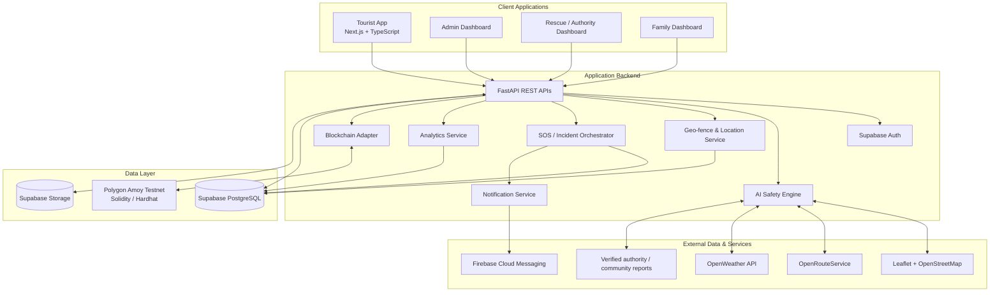

# System Design: Smart Tourist Safety Monitoring & Incident Response System

## 1. Purpose

Build a tourist-safety platform that combines AI-assisted hazard awareness, geo-fencing, live location sharing, emergency response, verified digital identity, and incident history.

The design follows the supplied problem statement and the SafeWay / Bharat 4.0 presentation material. The core travel-safety themes are hazard-aware routing, road and weather alerts, fair-price insights, verified service providers, one-tap SOS, and incident reporting.

## 2. High-Level Architecture

## 3. Main Components

### 3.1 Client Applications

- **Tourist App:** registration/login, trip planning, digital tourist ID, map, live location, geo-fence alerts, safety score, SOS, incident reporting, notifications, trip history, settings.
- **Admin Dashboard:** active-trip overview, tourist-ID verification, incident review, safe-zone management, rescue-team management, alerts, analytics.
- **Rescue / Authority Dashboard:** incoming SOS, incident location and category, permitted emergency details, route to tourist, status updates.
- **Family Dashboard:** location and safety status only when the tourist has explicitly granted access.

### 3.2 Backend Services

- **FastAPI REST API:** validates requests, applies access control, and coordinates the services.
- **Authentication and authorization:** Supabase Auth plus role-based permissions for tourist, family, authority, rescue team, guide/operator, and administrator.
- **AI Safety Engine:** combines weather, road conditions, crowd information where available, recent incidents, wildlife alerts, and user reports into risk levels and route recommendations. Display data freshness and source; do not treat model output as guaranteed truth.
- **Geo-fence and Location Service:** evaluates permitted location updates against configured safe zones and restricted areas. Sends alerts on exit/entry events.
- **SOS / Incident Orchestrator:** creates an incident record, captures timestamp and latest available GPS location, notifies configured contacts and authorized responders, and tracks response status.
- **Notification Service:** pushes alerts through Firebase Cloud Messaging and records delivery attempts.
- **Analytics Service:** calculates active trips, SOS counts, response times, incident types, and high-risk areas.
- **Blockchain Adapter:** submits only minimal verification proofs or hashes to Polygon Amoy. Keep personal and medical information off-chain.

### 3.3 Data and Integrations

| Component | Technology | Responsibility |
|---|---|---|
| Web client | Next.js, TypeScript | Application UI |
| Styling / UI | Tailwind CSS, shadcn/ui, Framer Motion | Responsive interface and interactions |
| Backend | FastAPI (Python) | REST APIs and business logic |
| Database | Supabase PostgreSQL | Users, trips, zones, incidents, SOS, audit metadata |
| Authentication | Supabase Auth | Login and session management |
| File storage | Supabase Storage | Incident media and profile photos with access controls |
| Maps | Leaflet, OpenStreetMap | Map rendering |
| Routing | OpenRouteService | Route and route alternatives |
| Weather | OpenWeather API | Weather conditions and alerts input |
| Push notifications | Firebase Cloud Messaging | Mobile/web push notifications |
| Digital ID ledger | Polygon Amoy, Solidity, Hardhat | Testnet proof/verification prototype |
| Deployment | Vercel, Render | Frontend and API hosting |

## 4. Core Data Model

Suggested entities and relationships:

- **users** (`id`, `auth_user_id`, `role`, `created_at`)
- **tourist_profiles** (`user_id`, `display_name`, `age_band_or_age`, `emergency_contact_ref`, `blood_group_optional`, `medical_notes_private`, `photo_path`, `verification_status`)
- **digital_ids** (`id`, `user_id`, `public_id`, `proof_hash`, `chain_tx_hash`, `issued_at`, `status`)
- **trips** (`id`, `user_id`, `destination`, `start_at`, `end_at`, `traveler_count`, `adventure_type`, `vehicle_type`, `status`)
- **location_updates** (`id`, `trip_id`, `latitude`, `longitude`, `speed`, `recorded_at`, `accuracy_m`)
- **geofences** (`id`, `name`, `geometry`, `zone_type`, `severity`, `source`, `active`)
- **geofence_events** (`id`, `trip_id`, `zone_id`, `event_type`, `location_update_id`, `created_at`)
- **safety_assessments** (`id`, `trip_id`, `score_or_level`, `factors_json`, `recommendation`, `created_at`)
- **incidents** (`id`, `reporter_user_id`, `trip_id`, `category`, `description`, `latitude`, `longitude`, `status`, `created_at`)
- **incident_media** (`id`, `incident_id`, `storage_path`, `media_type`, `access_policy`)
- **sos_requests** (`id`, `user_id`, `trip_id`, `latitude`, `longitude`, `created_at`, `status`, `assigned_team_id`)
- **rescue_teams** (`id`, `name`, `contact_ref`, `availability_status`, `last_known_location`)
- **notifications** (`id`, `user_id`, `type`, `payload_json`, `sent_at`, `delivery_status`)
- **service_providers** (`id`, `provider_type`, `name`, `verification_status`, `location`, `price_range`, `evidence_source`)
- **audit_events** (`id`, `actor_id`, `action`, `target_type`, `target_id`, `created_at`, `proof_hash`)

Use foreign keys, indexes on trip/user/time and geospatial fields, row-level security (RLS), retention policies, and least-privilege access.

## 5. Key API Groups

| Method | Endpoint | Purpose |
|---|---|---|
| POST | `/auth/register` | Create account/profile |
| POST | `/trips` | Create a trip |
| POST | `/trips/{id}/start` | Start location and safety monitoring |
| POST | `/location` | Submit location update |
| GET | `/trips/{id}/safety` | Read latest safety assessment |
| GET | `/geofences/nearby` | Fetch relevant zones |
| POST | `/incidents` | Submit incident report |
| POST | `/sos` | Trigger SOS |
| PATCH | `/sos/{id}` | Update rescue status |
| GET | `/services/nearby` | Find nearby emergency services |
| GET | `/digital-id/{public_id}/verify` | Verify public ID proof |
| GET | `/admin/analytics` | Read authorized aggregate metrics |

All endpoints need authentication where appropriate, authorization checks, input validation, rate limiting for sensitive operations, and audit logging.

## 6. Safety, Privacy, and Security

- Request location permission clearly and allow tracking to be stopped when a trip ends.
- Family location sharing is opt-in, scoped, and revocable.
- Keep passport/Aadhaar identifiers, medical details, emergency contacts, and precise location history off-chain.
- Store only a minimal proof/hash and non-sensitive verification status on the test blockchain.
- Restrict QR-code contents to a public ID and verification URL; require authorized access for private emergency data.
- Encrypt data in transit and use database/storage access policies.
- Treat AI results as advisory, show source and freshness, and provide a way to report incorrect alerts.
- Define retention/deletion rules for location and incident media.
- Plan a degraded-network mode: cache essential trip/ID information and expose emergency-call options; explain that live updates may fail without connectivity.

## 7. Suggested Hackathon Build Order

1. Authentication and tourist profile.
2. Trip creation, map, route, and weather display.
3. Location updates and safe/restricted-zone events.
4. SOS creation, incident records, and notification workflow.
5. Authority/rescue dashboard and status updates.
6. Digital ID QR verification.
7. Safety scoring and incident-category assistance.
8. Polygon Amoy proof-of-issuance prototype.
9. Analytics and UI polish.

## 8. MVP Acceptance Criteria

- A tourist can register, create a trip, view a route, and start/stop tracking.
- The app records a location update and produces a geo-fence event for a configured zone.
- A tourist can send an SOS with timestamp and last available location.
- An authorized responder can view the incident and update its status.
- A QR-based digital ID verifies against the backend and its testnet proof.
- A safety assessment shows risk factors, recommendation, and data freshness.
- Family sharing works only after explicit consent.
