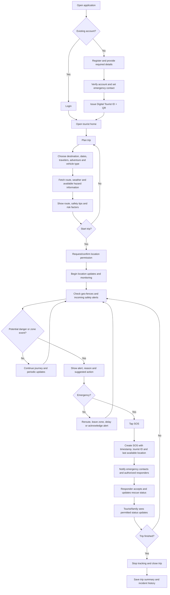
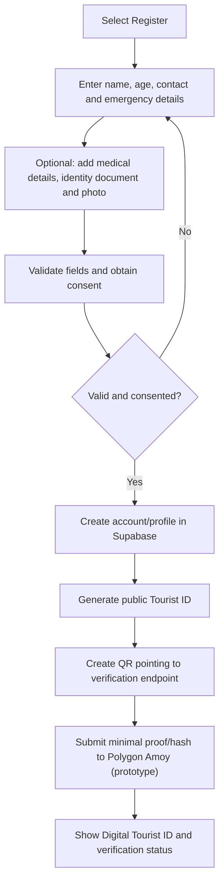
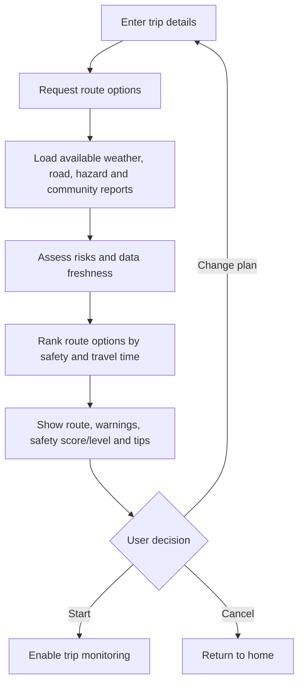
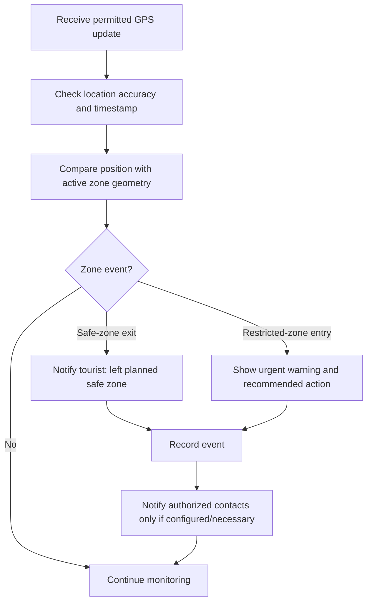
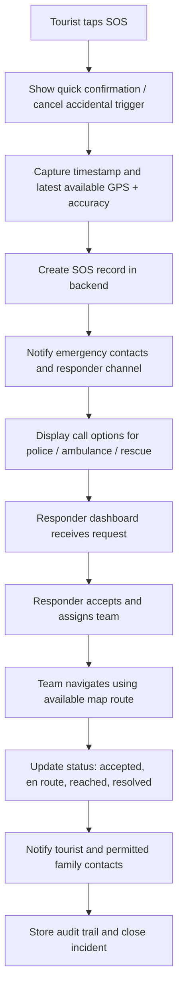
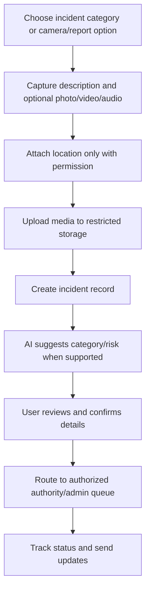
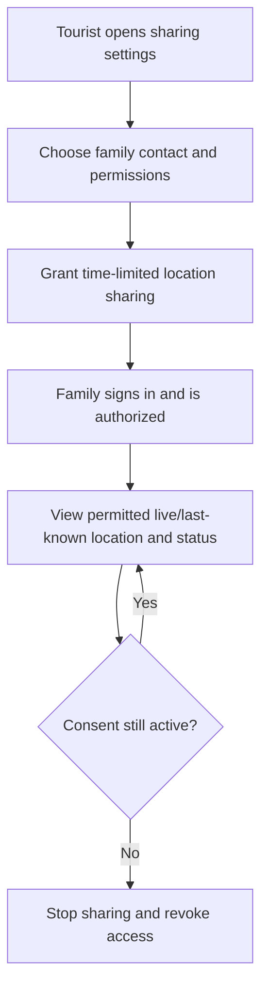

# User Flow: Smart Tourist Safety Monitoring & Incident Response System

## 1. End-to-End Primary Flow

## 2. Registration and Digital ID Flow

**Privacy rule:** personal documents, medical details, phone numbers, and exact location must remain off-chain. The QR should expose only a public identifier and verification endpoint; private details require authorized access.

## 3. Trip Planning and Safety Flow

Do not show a numeric safety score unless the scoring method is defined and tested. Clearly label unavailable or stale data.

## 4. Geo-Fence Event Flow

## 5. SOS and Rescue Response Flow

If connectivity is poor, retain the last known location and timestamp, clearly mark them as potentially stale, and expose direct phone-call options. Never imply that an alert was delivered until delivery is confirmed.

## 6. Incident Reporting and AI Vision Flow

AI output is a suggestion, not a confirmed diagnosis of the scene. Preserve the user's report and allow correction.

## 7. Family Dashboard Flow

## 8. Admin and Rescue Team Flows

### Admin
1. Sign in with an authorized admin role.
2. Review active trips, alerts, reports, and SOS requests.
3. Verify tourist ID proofs and service-provider records.
4. Manage geo-fence zones and publish authorized alerts.
5. Assign or monitor rescue teams where the system supports it.
6. Review aggregate analytics and audit events.

### Rescue team
1. Sign in and receive assigned SOS/incident requests.
2. Review location freshness, incident type, and only the emergency details required for response.
3. Accept the request and open navigation.
4. Update status as en route, reached, and resolved.
5. Add response notes and close the request.

## 9. Exception Paths to Test

- GPS permission denied or location accuracy is poor.
- Network unavailable, delayed push notifications, or stale weather/road data.
- Duplicate SOS taps or accidental SOS cancellation.
- QR code invalid, revoked, or blockchain testnet unavailable.
- Incident media upload fails.
- User exits a safe zone but GPS uncertainty makes the event ambiguous.
- Family access is revoked while a trip is active.
- No rescue team is available.
- AI classification confidence is low or wrong.

## 10. MVP User Journey Checklist

- [ ] Register/login and create a tourist profile.
- [ ] Display a QR-based digital tourist ID.
- [ ] Plan a trip and view route/weather/hazard information.
- [ ] Start and stop location monitoring with permission.
- [ ] Trigger and record geo-fence events.
- [ ] Send SOS and show delivery/response status accurately.
- [ ] Report an incident with optional media.
- [ ] Let an authorized responder update the case.
- [ ] View trip and incident history.
- [ ] Demonstrate a testnet proof without placing sensitive personal data on-chain.
